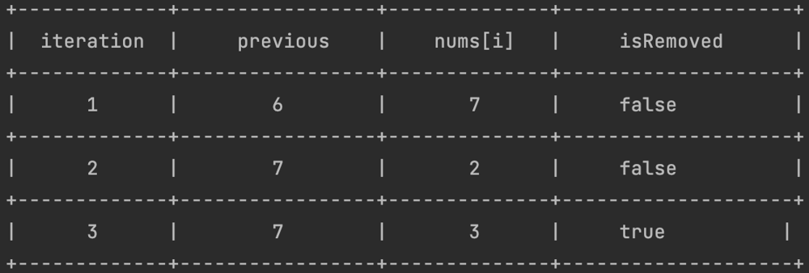

# 94,74% on Kotlin

**Author:** kabrishka
**Votes:** 5
**Link:** [https://leetcode.com/problems/remove-one-element-to-make-the-array-strictly-increasing/solutions/3162196/](https://leetcode.com/problems/remove-one-element-to-make-the-array-strictly-increasing/solutions/3162196/)

---

# Intuition
<!-- Describe your first thoughts on how to solve this problem. -->
The array nums is strictly increasing if nums[i - 1] < nums[i] for each index (1 <= i < nums.length).

> If two elements in the subsequence do not increase, you need to understand which of the elements you need to delete

# Approach
<!-- Describe your approach to solving the problem. -->
Let's declare a string that will point to the previous element of the sequence. At the very beginning, the variable contained the first element of nums.
The isRemoved variable shows whether we have used element deletion or not (the deletion is figurative, in fact the array does not change)
1. We start iterations not from index 0, but from 1;
2. If the current element is less than or equal to the previous one (nums[i] <= previous) => 
        - If the previous element of the sequence has already been deleted (it is also the largest element) => the sequence decreases => we complete the calculation 
        - If the previous element was not deleted => at the current iteration we delete it => isRemoved = true 
        - If the current index of the element == 1 or the current element is greater than the element to the left of the previous one, those nums[i] > nums[i - 2] => the sequence increases => at the end of the iteration, the current element becomes the previous one (previous = nums[i])
3. If the current element is larger than the previous one => the sequence increases => at the end of the iteration, the current element becomes the previous one (previous = nums[i]);
4. If no element was deleted, or after deleting the element there was no exit due to decreasing sequence => the sequence will increase.

For example, for [6,7,3,4,5] 




# Complexity
- Time complexity: $$O(n)$$
<!-- Add your time complexity here, e.g. $$O(n)$$ -->

- Space complexity: $$O(1)$$
<!-- Add your space complexity here, e.g. $$O(n)$$ -->

# Code
```
class Solution {
    fun canBeIncreasing(nums: IntArray): Boolean {
        var previous = nums[0]
        var isRemoved = false
        for (i in 1 until nums.size) {
            if (nums[i] <= previous) {
                if (isRemoved) return false
                isRemoved = true
                if (i == 1 || nums[i] > nums[i - 2])
                    previous = nums[i]
            } else previous = nums[i]
        }
        return true
    }
}
```