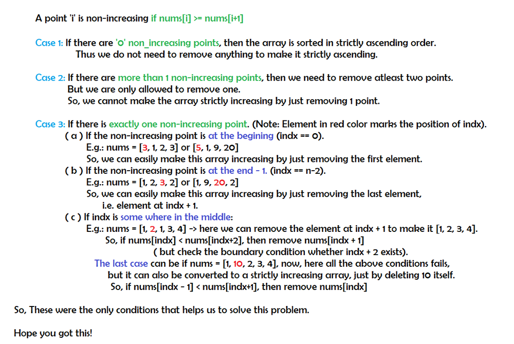

# Python: Explained: Easy to understand: O(n) Time and O(1) Space

**Author:** meaditya70
**Votes:** 82
**Link:** [https://leetcode.com/problems/remove-one-element-to-make-the-array-strictly-increasing/solutions/1298517/](https://leetcode.com/problems/remove-one-element-to-make-the-array-strictly-increasing/solutions/1298517/)

---



The Full Code:
```
class Solution:
    def canBeIncreasing(self, nums: List[int]) -> bool:
        indx = -1
        count = 0
        n = len(nums)
        
        # count the number of non-increasing elements
        for i in range(n-1):
            if nums[i] >= nums[i+1]:
                indx = i
                count += 1
        
        #the cases explained above
        if count==0:
            return True
        
        if count == 1:
            if indx == 0 or indx == n-2:
                return True
            if nums[indx-1] < nums[indx+1] or(indx+2 < n and nums[indx] < nums[indx+2]):
                return True
            
        return False
```
Time: O(n) for counting the number of non-increasing elements.
Space = O(1).