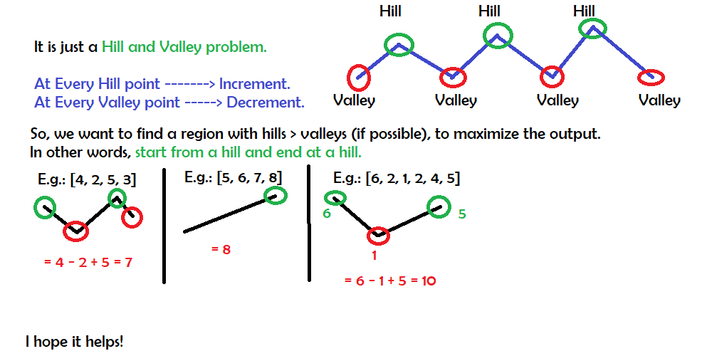

# Python: Easy to understand: Explained: O(n) Time and O(1) Space

**Author:** meaditya70
**Votes:** 34
**Link:** [https://leetcode.com/problems/maximum-alternating-subsequence-sum/solutions/1298606/](https://leetcode.com/problems/maximum-alternating-subsequence-sum/solutions/1298606/)

---



```
class Solution:
    def maxAlternatingSum(self, nums: List[int]) -> int:
        ans = 0
        direction = 'down'
        n = len(nums)
        for i in range(n-1):
            if direction == 'down' and nums[i] >= nums[i+1]:
                ans += nums[i]
                direction = 'up'
            elif direction == 'up' and nums[i] <= nums[i+1]:
                ans -= nums[i]
                direction = 'down'
        if direction == 'up':
            return ans
        return ans + nums[-1]
```
