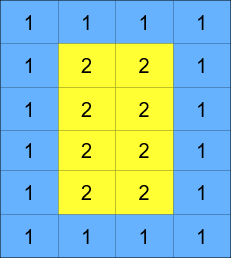
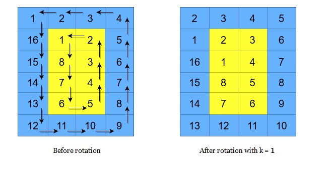
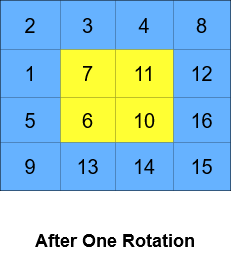
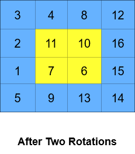

# [1914. Cyclically Rotating a Grid](https://leetcode.com/problems/cyclically-rotating-a-grid/)

| Category | Difficulty | Likes | Dislikes |
| :------: | :--------: | :---: | :------: |
| Algorithms | Medium | 265 | 278 |

**Tags:** [`array`](https://leetcode.com/tag/array), [`matrix`](https://leetcode.com/tag/matrix), [`simulation`](https://leetcode.com/tag/simulation)


## Description

You are given an `m x n` integer matrix `grid`​​​, where `m` and `n` are both **even** integers, and an integer `k`.


The matrix is composed of several layers, which is shown in the below image, where each color is its own layer:





A cyclic rotation of the matrix is done by cyclically rotating **each layer** in the matrix. To cyclically rotate a layer once, each element in the layer will take the place of the adjacent element in the **counter-clockwise** direction. An example rotation is shown below:



Return *the matrix after applying *`k` *cyclic rotations to it*.


 


**Example 1:**


```

Input: grid = [[40,10],[30,20]], k = 1
Output: [[10,20],[40,30]]
Explanation: The figures above represent the grid at every state.

```


**Example 2:**

**** **** ****

```

Input: grid = [[1,2,3,4],[5,6,7,8],[9,10,11,12],[13,14,15,16]], k = 2
Output: [[3,4,8,12],[2,11,10,16],[1,7,6,15],[5,9,13,14]]
Explanation: The figures above represent the grid at every state.

```


 


**Constraints:**


	- `m == grid.length`

	- `n == grid[i].length`

	- `2 <= m, n <= 50`

	- Both `m` and `n` are **even** integers.

	- `1 <= grid[i][j] <=^ 5000`

	- `1 <= k <= 10^9`

---

**Links:** [Submissions](https://leetcode.com/problems/cyclically-rotating-a-grid/) | [Solutions](https://leetcode.com/problems/cyclically-rotating-a-grid/)
