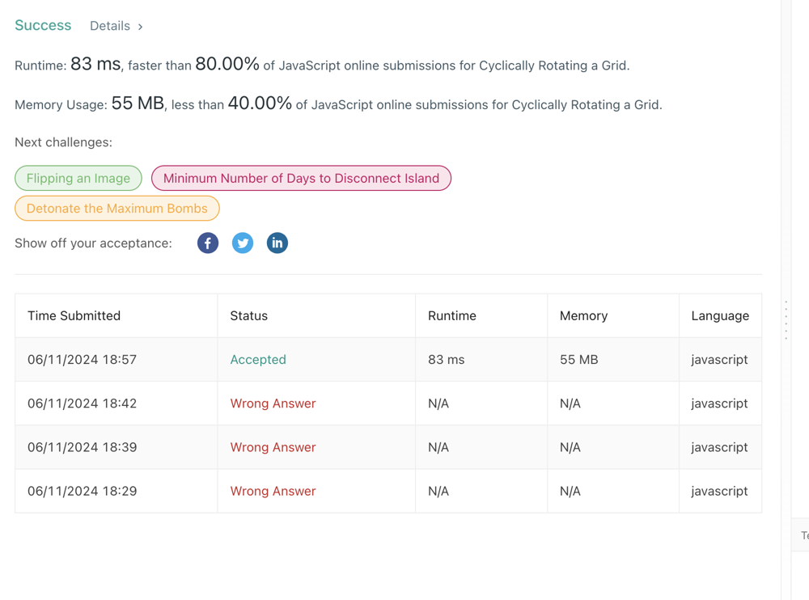
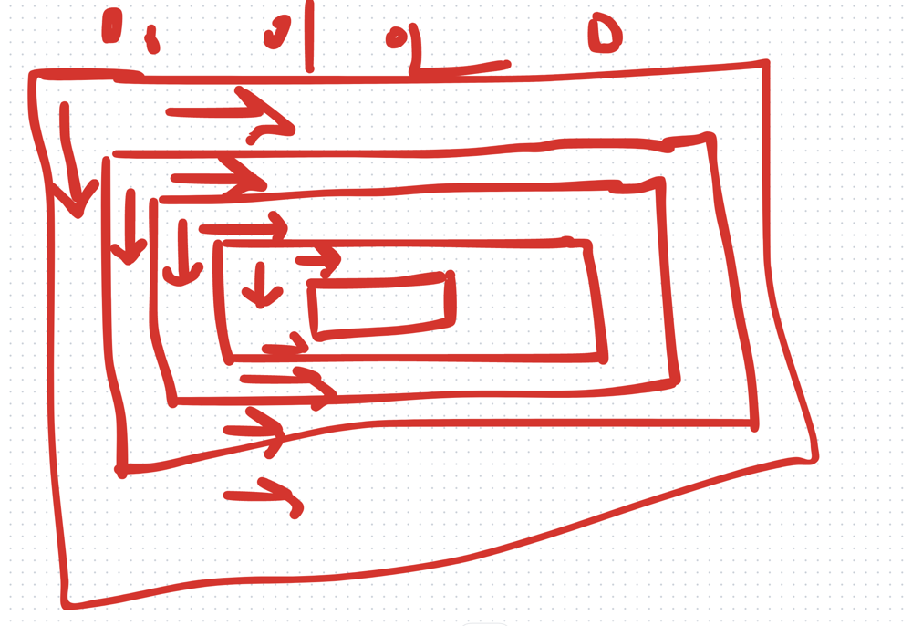

# ❇ cyclically-rotating-a-grid👌 🏆O(N)❤️ Javascript🎯 Memory👀 80.00%🕕 ++Explanation✍️ 🔴🔥 ✅ 👉

**Author:** anurag-sindhu
**Votes:** 2
**Link:** [https://leetcode.com/problems/cyclically-rotating-a-grid/solutions/5295835/](https://leetcode.com/problems/cyclically-rotating-a-grid/solutions/5295835/)

---


Time Complexity: O(N*M)
Space Complexity: O(1)
```
function findRotatedGrid(grid, rowIndex) {
    let store = null;
    let columnIndex = null;
    let curRowIndex = null;
    // Top to bottom
    columnIndex = rowIndex;
    curRowIndex = rowIndex;
    for (; curRowIndex < grid.length - rowIndex; curRowIndex++) {
        if (store !== null) {
            const tempStore = grid[curRowIndex][columnIndex];
            grid[curRowIndex][columnIndex] = store;
            store = tempStore;
        } else {
            store = grid[curRowIndex][columnIndex];
        }
    }
    // Left to right
    columnIndex = rowIndex + 1;
    curRowIndex = grid.length - rowIndex - 1;
    for (; columnIndex < grid[rowIndex].length - rowIndex; columnIndex++) {
        const tempStore = grid[curRowIndex][columnIndex];
        grid[curRowIndex][columnIndex] = store;
        store = tempStore;
    }
    // Bottom to top
    curRowIndex = grid.length - rowIndex - 1 - 1;
    columnIndex = grid[rowIndex].length - rowIndex - 1;
    for (; curRowIndex >= rowIndex; curRowIndex--) {
        const tempStore = grid[curRowIndex][columnIndex];
        grid[curRowIndex][columnIndex] = store;
        store = tempStore;
    }
    //Right to left
    columnIndex = grid[rowIndex].length - rowIndex - 1 - 1;
    curRowIndex = rowIndex;
    for (; columnIndex >= rowIndex; columnIndex--) {
        const tempStore = grid[curRowIndex][columnIndex];
        grid[curRowIndex][columnIndex] = store;
        store = tempStore;
    }
    return;
}

var rotateGrid = function (grid, k) {
    const gridSize = Math.min(grid.length, grid[0].length) / 2;
    for (let rowIndex = 0; rowIndex < gridSize; rowIndex++) {
        const totalCircleSize =
            2 * (grid.length - 2 * rowIndex) + 2 * (grid[0].length - 2 * rowIndex) - 4;
        let circleSize = k % totalCircleSize;
        while (circleSize--) {
            findRotatedGrid(grid, rowIndex);
        }
    }
    return grid;
};
```



