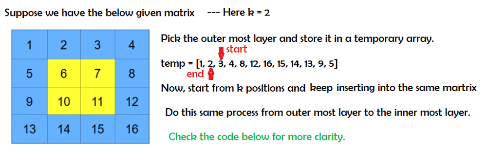

# Python: All possible methods Explained

**Author:** meaditya70
**Votes:** 19
**Link:** [https://leetcode.com/problems/cyclically-rotating-a-grid/solutions/1299632/](https://leetcode.com/problems/cyclically-rotating-a-grid/solutions/1299632/)

---

**Method 1: The naive method**
Rotate the Matrix layer by layer K times -> Time = O(m * n * k) and since k = 10^9, it will give TLE.

**METHOD 2: Rotate K times in one Go**


```
class Solution:
    def rotateGrid(self, grid: List[List[int]], k: int) -> List[List[int]]:
        n = len(grid)
        m = len(grid[0])
        
        i, j = 0, 0
        bottom, right = n-1, m-1 
        while i < n//2 and j < m//2:
            temp = []
            for x in range(j, right):
                temp.append(grid[i][x])
            for x in range(i, bottom):
                temp.append(grid[x][right])
            for x in range(right, j, -1):
                temp.append(grid[bottom][x])
            for x in range(bottom, i, -1):
                temp.append(grid[x][j])
                
            
            indx = 0
            for x in range(j, right):
                grid[i][x] = temp[(k + indx)%len(temp)]
                indx += 1
            for x in range(i, bottom):
                grid[x][right] = temp[(k + indx)%len(temp)]
                indx += 1
            for x in range(right, j, -1):
                grid[bottom][x] = temp[(k + indx)%len(temp)]
                indx += 1
            for x in range(bottom, i, -1):
                grid[x][j] = temp[(k + indx)%len(temp)]
                indx += 1
                
            i += 1
            j += 1
            bottom -= 1
            right -= 1
        return grid
```
Time = O(n * m) for matrix traversal.
Space = O(n) for the temp array, but still since the same matrix is modified, Hence it is an **in-place solution**.