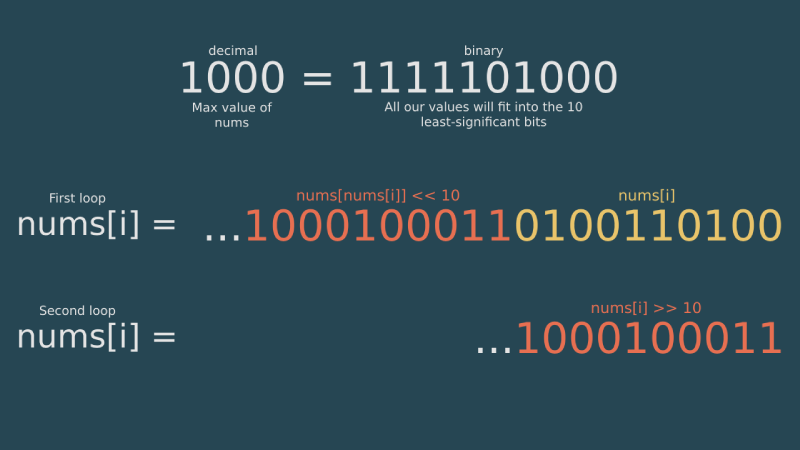

# Java | O(1) Space / O(n) Time

**Author:** EOAndersson
**Votes:** 129
**Link:** [https://leetcode.com/problems/build-array-from-permutation/solutions/1315480/](https://leetcode.com/problems/build-array-from-permutation/solutions/1315480/)

---

Firstly, the naive O(n) space solution practically appears in full in the problem statement, so having it be a part of a weekly contest is questionable. A simple solution would look something like this:
```
public int[] buildArray(int[] nums) {
	int[] ans = new int[nums.length];
	for(int i = 0; i < nums.length; i++)
		ans[i] = nums[nums[i]];
	return ans;
}
```

In order to optimize the solution somewhat, and to meet the Follow-Up requirement for O(1) space complexity, we can rely on bit-shifting, something which is possible due to the low values in `nums`. My solution is as follows:

```
public int[] buildArray(int[] nums) {
	int mask = 1023; // Decimal value of the binary number '1111111111'
	for(int i = 0; i < nums.length; i++)
		nums[i] |= (nums[nums[i]] & mask) << 10;
	for(int i = 0; i < nums.length; i++)
		nums[i] = nums[i] >> 10;
	return nums;
}
```

**EDIT:** Here's an image I made to somewhat illustrate the process:

