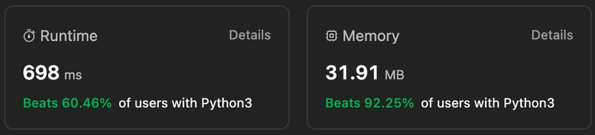

# ✅ Beats 92.25% 🔥 || ⭐️ Detailed Explanation for Beginners 💡||

**Author:** Gourav-2002
**Votes:** 8
**Link:** [https://leetcode.com/problems/eliminate-maximum-number-of-monsters/solutions/4258930/](https://leetcode.com/problems/eliminate-maximum-number-of-monsters/solutions/4258930/)

---



# Intuition:
**Here we are given two arrays, one with the distance of each monster from the city and the other with the speed of each monster. We need to find the maximum number of monsters we can kill before they reach the city. We can kill a monster if we reach the monster before it reaches the city. We can reach the monster if the time taken to reach the monster is less than or equal to the time taken by the monster to reach the city. So, we need to find the time taken by each monster to reach the city and sort them in ascending order. Then we can iterate through the time array and check if the time taken by the monster to reach the city is less than or equal to the time taken by us to reach the monster. If it is less than or equal to, then we can kill the monster and increment the count. If not, then we cannot kill the monster and we can break the loop and return the count.**

# Algorithm: Using Sorting and Greedy Approach
1. Create a time array and store the time taken by each monster to reach the city.
2. Sort the time array in ascending order.
3. Iterate through the time array and check if the time taken by the monster to reach the city is less than or equal to the time taken by us to reach the monster.
4. If it is less than or equal to, then we can kill the monster and increment the count.
5. If not, then we cannot kill the monster and we can break the loop and return the count.

# Complexity Analysis:
- Time Complexity: **O(NlogN)**, where N is the length of the given arrays.
- Space Complexity: **O(N)**, where N is the length of the given arrays.

## Please UpVote\u2B06\uFE0F if this helps you.

# Code
``` Python []
class Solution:
    def eliminateMaximum(self, dist: List[int], speed: List[int]) -> int:

        if not dist or not speed:
            return 0
        
        time = [0] * len(dist)
        for i in range(len(dist)):
            time[i] = dist[i] / speed[i]

        time.sort()
        count = 0
        for i in range(len(time)):
            if time[i] <= i:
                break
            count += 1
        return count 
```
``` C++ []
class Solution {
public:
    int eliminateMaximum(std::vector<int>& dist, std::vector<int>& speed) {
        if (dist.empty() || speed.empty()) {
            return 0;
        }

        std::vector<double> time(dist.size());
        for (size_t i = 0; i < dist.size(); ++i) {
            time[i] = static_cast<double>(dist[i]) / speed[i];
        }

        std::sort(time.begin(), time.end());

        int count = 0;
        for (size_t i = 0; i < time.size(); ++i) {
            if (time[i] <= i) {
                break;
            }
            ++count;
        }

        return count;
    }
};
```
``` Java []
class Solution {
    public int eliminateMaximum(int[] dist, int[] speed) {
        if (dist.length == 0 || speed.length == 0) {
            return 0;
        }

        double[] time = new double[dist.length];
        for (int i = 0; i < dist.length; i++) {
            time[i] = (double) dist[i] / speed[i];
        }

        Arrays.sort(time);

        int count = 0;
        for (int i = 0; i < time.length; i++) {
            if (time[i] <= i) {
                break;
            }
            count++;
        }

        return count;
    }
}
```
``` C# []
public class Solution {
    public int EliminateMaximum(int[] dist, int[] speed) {
        if (dist.Length == 0 || speed.Length == 0) {
            return 0;
        }

        double[] time = new double[dist.Length];
        for (int i = 0; i < dist.Length; i++) {
            time[i] = (double) dist[i] / speed[i];
        }

        Array.Sort(time);

        int count = 0;
        for (int i = 0; i < time.Length; i++) {
            if (time[i] <= i) {
                break;
            }
            count++;
        }

        return count;
    }
}
```
``` JavaScript []
/**
 * @param {number[]} dist
 * @param {number[]} speed
 * @return {number}
 */
var eliminateMaximum = function(dist, speed) {
    if (dist.length === 0 || speed.length === 0) {
            return 0;
        }

        const time = dist.map((d, i) => d / speed[i]);

        time.sort((a, b) => a - b);

        let count = 0;
        for (let i = 0; i < time.length; i++) {
            if (time[i] <= i) {
                break;
            }
            count++;
        }

        return count;
};
```
``` TypeScript []
function eliminateMaximum(dist: number[], speed: number[]): number {
    if (dist.length === 0 || speed.length === 0) {
            return 0;
        }

        const time: number[] = dist.map((d, i) => d / speed[i]);

        time.sort((a, b) => a - b);

        let count = 0;
        for (let i = 0; i < time.length; i++) {
            if (time[i] <= i) {
                break;
            }
            count++;
        }

        return count;
};
```
``` PHP []
class Solution {

    /**
     * @param Integer[] $dist
     * @param Integer[] $speed
     * @return Integer
     */
    function eliminateMaximum($dist, $speed) {
        if (empty($dist) || empty($speed)) {
            return 0;
        }

        $time = array();
        foreach ($dist as $i => $d) {
            $time[$i] = $d / $speed[$i];
        }

        asort($time);

        $count = 0;
        foreach ($time as $i => $t) {
            if ($t <= $i) {
                break;
            }
            $count++;
        }

        return $count;
    }
}
```
``` Ruby []
# @param {Integer[]} dist
# @param {Integer[]} speed
# @return {Integer}
def eliminate_maximum(dist, speed)
    return 0 if dist.empty? || speed.empty?

    time = dist.map.with_index { |d, i| d.to_f / speed[i] }

    time.sort!

    count = 0
    time.each_with_index do |t, i|
      break if t <= i

      count += 1
    end

    count
end
```

