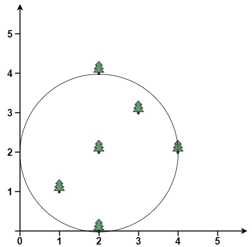
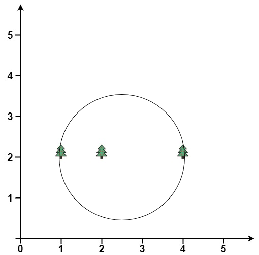

# [1924. Erect the Fence II](https://leetcode.com/problems/erect-the-fence-ii/)

| Category | Difficulty | Likes | Dislikes |
| :------: | :--------: | :---: | :------: |
| Algorithms | Hard | 15 | 44 |

**Tags:** [`array`](https://leetcode.com/tag/array), [`math`](https://leetcode.com/tag/math), [`geometry`](https://leetcode.com/tag/geometry)

**Companies:** `google`

## Description

You are given a 2D integer array `trees` where `trees[i] = [x_i, y_i]` represents the location of the `i^th` tree in the garden.

You are asked to fence the entire garden using the minimum length of rope possible. The garden is well-fenced only if **all the trees are enclosed** and the rope used **forms a perfect circle**. A tree is considered enclosed if it is inside or on the border of the circle.

More formally, you must form a circle using the rope with a center `(x, y)` and radius `r` where all trees lie inside or on the circle and `r` is **minimum**.

Return *the center and radius of the circle as a length 3 array *`[x, y, r]`*.* Answers within `10^-5` of the actual answer will be accepted.

 

**Example 1:**

****

```

Input: trees = [[1,1],[2,2],[2,0],[2,4],[3,3],[4,2]]
Output: [2.00000,2.00000,2.00000]
Explanation: The fence will have center = (2, 2) and radius = 2

```

**Example 2:**

****

```

Input: trees = [[1,2],[2,2],[4,2]]
Output: [2.50000,2.00000,1.50000]
Explanation: The fence will have center = (2.5, 2) and radius = 1.5

```

 

**Constraints:**

	- `1 <= trees.length <= 3000`

	- `trees[i].length == 2`

	- `0 <= x_i, y_i <= 3000`

---

**Links:** [Submissions](https://leetcode.com/problems/erect-the-fence-ii/) | [Solutions](https://leetcode.com/problems/erect-the-fence-ii/)
