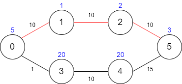
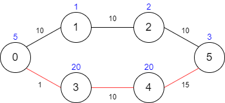

# [1928. Minimum Cost to Reach Destination in Time](https://leetcode.com/problems/minimum-cost-to-reach-destination-in-time/)

| Category | Difficulty | Likes | Dislikes |
| :------: | :--------: | :---: | :------: |
| Algorithms | Hard | 939 | 22 |

**Tags:** [`array`](https://leetcode.com/tag/array), [`dynamic-programming`](https://leetcode.com/tag/dynamic-programming), [`graph`](https://leetcode.com/tag/graph)

**Companies:** `amazon`, `facebook`

## Description

There is a country of `n` cities numbered from `0` to `n - 1` where **all the cities are connected** by bi-directional roads. The roads are represented as a 2D integer array `edges` where `edges[i] = [x_i, y_i, time_i]` denotes a road between cities `x_i` and `y_i` that takes `time_i` minutes to travel. There may be multiple roads of differing travel times connecting the same two cities, but no road connects a city to itself.

Each time you pass through a city, you must pay a passing fee. This is represented as a **0-indexed** integer array `passingFees` of length `n` where `passingFees[j]` is the amount of dollars you must pay when you pass through city `j`.

In the beginning, you are at city `0` and want to reach city `n - 1` in `maxTime`** minutes or less**. The **cost** of your journey is the **summation of passing fees** for each city that you passed through at some moment of your journey (**including** the source and destination cities).

Given `maxTime`, `edges`, and `passingFees`, return *the **minimum cost** to complete your journey, or *`-1`* if you cannot complete it within *`maxTime`* minutes*.

 

**Example 1:**



```

Input: maxTime = 30, edges = [[0,1,10],[1,2,10],[2,5,10],[0,3,1],[3,4,10],[4,5,15]], passingFees = [5,1,2,20,20,3]
Output: 11
Explanation: The path to take is 0 -&gt; 1 -&gt; 2 -&gt; 5, which takes 30 minutes and has $11 worth of passing fees.

```

**Example 2:**

****

```

Input: maxTime = 29, edges = [[0,1,10],[1,2,10],[2,5,10],[0,3,1],[3,4,10],[4,5,15]], passingFees = [5,1,2,20,20,3]
Output: 48
Explanation: The path to take is 0 -&gt; 3 -&gt; 4 -&gt; 5, which takes 26 minutes and has $48 worth of passing fees.
You cannot take path 0 -&gt; 1 -&gt; 2 -&gt; 5 since it would take too long.

```

**Example 3:**

```

Input: maxTime = 25, edges = [[0,1,10],[1,2,10],[2,5,10],[0,3,1],[3,4,10],[4,5,15]], passingFees = [5,1,2,20,20,3]
Output: -1
Explanation: There is no way to reach city 5 from city 0 within 25 minutes.

```

 

**Constraints:**

	- `1 <= maxTime <= 1000`

	- `n == passingFees.length`

	- `2 <= n <= 1000`

	- `n - 1 <= edges.length <= 1000`

	- `0 <= x_i, y_i <= n - 1`

	- `1 <= time_i <= 1000`

	- `1 <= passingFees[j] <= 1000` 

	- The graph may contain multiple edges between two nodes.

	- The graph does not contain self loops.

---

**Links:** [Submissions](https://leetcode.com/problems/minimum-cost-to-reach-destination-in-time/) | [Solutions](https://leetcode.com/problems/minimum-cost-to-reach-destination-in-time/)
