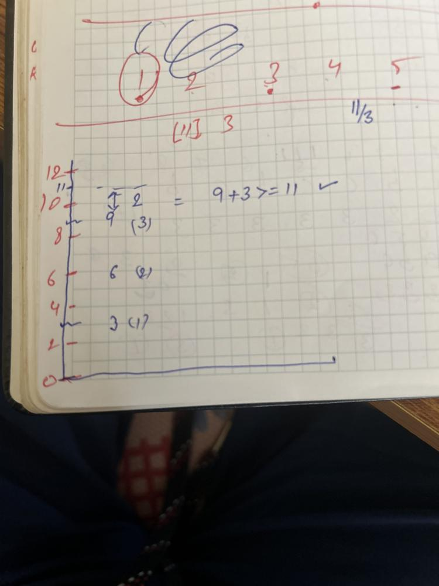
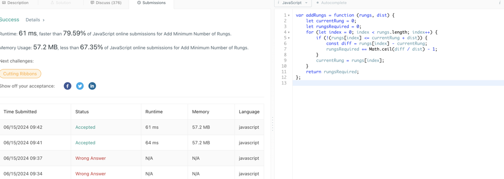

# ❇ add-minimum-number-of-rungs Images👌 🏆O(N)❤️ Javascript🎯 Memory👀95.45%🕕 ++Explanation✍️🔴🔥✅💪

**Author:** anurag-sindhu
**Votes:** 2
**Link:** [https://leetcode.com/problems/add-minimum-number-of-rungs/solutions/5315463/](https://leetcode.com/problems/add-minimum-number-of-rungs/solutions/5315463/)

---


Time Complexity: O(N)
Space Complexity: O(1)
```
var addRungs = function (rungs, dist) {
    let currentRung = 0;
    let rungsRequired = 0;
    for (let index = 0; index < rungs.length; index++) {
        if (!(rungs[index] <= currentRung + dist)) {
            const diff = rungs[index] - currentRung;
            rungsRequired += Math.ceil(diff / dist) - 1;
        }
        currentRung = rungs[index];
    }
    return rungsRequired;
};

```




