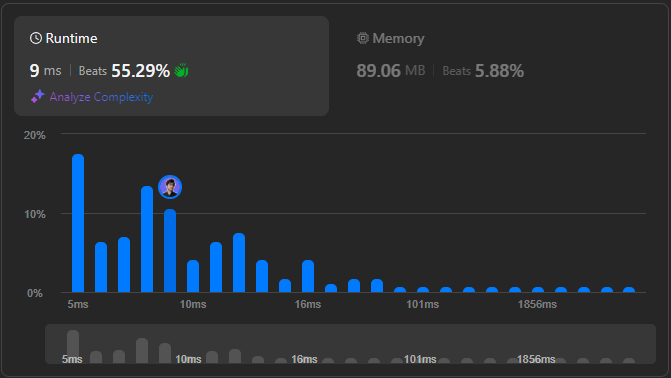

# 🌟 Mastering Point Optimization Across Multiple Languages 🔥💯

**Author:** withaarzoo
**Votes:** 31
**Link:** [https://leetcode.com/problems/maximum-number-of-points-with-cost/solutions/5647847/](https://leetcode.com/problems/maximum-number-of-points-with-cost/solutions/5647847/)

---


Explore a collection of solutions to LeetCode problems in multiple programming languages. Each solution includes a detailed explanation and step-by-step approach to solving the problem efficiently. Whether you're a beginner looking to learn or an experienced coder seeking optimized solutions, this repository aims to provide clear and insightful approaches to tackling challenging LeetCode problems.

### **Access daily LeetCode Solutions Repo :** [click here](https://github.com/withaarzoo/LeetCode-Solutions)

---



# Intuition
<!-- Describe your initial thoughts and strategy to solve this problem. -->
The problem is about maximizing the sum of points from a grid, where picking cells from different columns in consecutive rows incurs a penalty. This suggests that a dynamic programming approach is suitable, where we keep track of the maximum points that can be accumulated row by row. The challenge is efficiently calculating the maximum points considering the penalties.

# Approach
<!-- Detail the specific method and steps you used to solve the problem. -->
1. **Dynamic Programming (DP) Table**: We maintain a DP array `dp[c]` where `c` is the column index, and `dp[c]` represents the maximum points obtainable up to the current row if we choose the column `c` in this row.
2. **Transition between Rows**: For each row, compute the maximum points for each column considering:
   - Moving left to right (`leftMax`) to handle penalties from leftwards moves.
   - Moving right to left (`rightMax`) to handle penalties from rightwards moves.
3. **Update DP Array**: For each column in the current row, update `dp[c]` by considering the maximum possible value from the previous row minus the penalty.

# Complexity
- **Time complexity**:  
  $$O(m \	imes n)$$  
  where \\(m\\) is the number of rows and \\(n\\) is the number of columns. We process each cell once.
  
- **Space complexity**:  
  $$O(n)$$  
  Since we use only a single row for the DP array.

# Code
```C++ []
class Solution {
public:
    long long maxPoints(vector<vector<int>>& points) {
        int m = points.size();
        int n = points[0].size();
        vector<long long> dp(n, 0);

        // Initialize dp with the first row
        for (int j = 0; j < n; ++j) {
            dp[j] = points[0][j];
        }

        // Traverse through each row
        for (int i = 1; i < m; ++i) {
            vector<long long> leftMax(n), rightMax(n), newDp(n);
            
            // Calculate left max
            leftMax[0] = dp[0];
            for (int j = 1; j < n; ++j) {
                leftMax[j] = max(leftMax[j - 1], dp[j] + j);
            }
            
            // Calculate right max
            rightMax[n - 1] = dp[n - 1] - (n - 1);
            for (int j = n - 2; j >= 0; --j) {
                rightMax[j] = max(rightMax[j + 1], dp[j] - j);
            }
            
            // Calculate new DP for the current row
            for (int j = 0; j < n; ++j) {
                newDp[j] = max(leftMax[j] - j, rightMax[j] + j) + points[i][j];
            }
            
            dp = newDp;
        }

        return *max_element(dp.begin(), dp.end());
    }
};

```
```Java []
class Solution {
    public long maxPoints(int[][] points) {
        int m = points.length;
        int n = points[0].length;
        long[] dp = new long[n];

        // Initialize dp with the first row
        for (int j = 0; j < n; ++j) {
            dp[j] = points[0][j];
        }

        // Traverse through each row
        for (int i = 1; i < m; ++i) {
            long[] leftMax = new long[n];
            long[] rightMax = new long[n];
            long[] newDp = new long[n];

            // Calculate left max
            leftMax[0] = dp[0];
            for (int j = 1; j < n; ++j) {
                leftMax[j] = Math.max(leftMax[j - 1], dp[j] + j);
            }

            // Calculate right max
            rightMax[n - 1] = dp[n - 1] - (n - 1);
            for (int j = n - 2; j >= 0; --j) {
                rightMax[j] = Math.max(rightMax[j + 1], dp[j] - j);
            }

            // Calculate new DP for the current row
            for (int j = 0; j < n; ++j) {
                newDp[j] = Math.max(leftMax[j] - j, rightMax[j] + j) + points[i][j];
            }

            dp = newDp;
        }

        long maxPoints = dp[0];
        for (int j = 1; j < n; ++j) {
            maxPoints = Math.max(maxPoints, dp[j]);
        }
        return maxPoints;
    }
}

```
```JavaScript []
/**
 * @param {number[][]} points
 * @return {number}
 */
var maxPoints = function(points) {
    const m = points.length;
    const n = points[0].length;
    let dp = Array(n).fill(0);

    // Initialize dp with the first row
    for (let j = 0; j < n; ++j) {
        dp[j] = points[0][j];
    }

    // Traverse through each row
    for (let i = 1; i < m; ++i) {
        const leftMax = Array(n).fill(0);
        const rightMax = Array(n).fill(0);
        const newDp = Array(n).fill(0);

        // Calculate left max
        leftMax[0] = dp[0];
        for (let j = 1; j < n; ++j) {
            leftMax[j] = Math.max(leftMax[j - 1], dp[j] + j);
        }

        // Calculate right max
        rightMax[n - 1] = dp[n - 1] - (n - 1);
        for (let j = n - 2; j >= 0; --j) {
            rightMax[j] = Math.max(rightMax[j + 1], dp[j] - j);
        }

        // Calculate new DP for the current row
        for (let j = 0; j < n; ++j) {
            newDp[j] = Math.max(leftMax[j] - j, rightMax[j] + j) + points[i][j];
        }

        dp = newDp;
    }

    return Math.max(...dp);
};

```
```Python []
class Solution:
    def maxPoints(self, points: List[List[int]]) -> int:
        m, n = len(points), len(points[0])
        dp = [0] * n

        # Initialize dp with the first row
        for j in range(n):
            dp[j] = points[0][j]

        # Traverse through each row
        for i in range(1, m):
            leftMax = [0] * n
            rightMax = [0] * n
            newDp = [0] * n

            # Calculate left max
            leftMax[0] = dp[0]
            for j in range(1, n):
                leftMax[j] = max(leftMax[j - 1], dp[j] + j)

            # Calculate right max
            rightMax[n - 1] = dp[n - 1] - (n - 1)
            for j in range(n - 2, -1, -1):
                rightMax[j] = max(rightMax[j + 1], dp[j] - j)

            # Calculate new DP for the current row
            for j in range(n):
                newDp[j] = max(leftMax[j] - j, rightMax[j] + j) + points[i][j]

            dp = newDp

        return max(dp)

```
```Go []
func maxPoints(points [][]int) int64 {
    m, n := len(points), len(points[0])
    dp := make([]int64, n)

    // Initialize dp with the first row
    for j := 0; j < n; j++ {
        dp[j] = int64(points[0][j])
    }

    // Traverse through each row
    for i := 1; i < m; i++ {
        leftMax := make([]int64, n)
        rightMax := make([]int64, n)
        newDp := make([]int64, n)

        // Calculate left max
        leftMax[0] = dp[0]
        for j := 1; j < n; j++ {
            leftMax[j] = max(leftMax[j-1], dp[j]+int64(j))
        }

        // Calculate right max
        rightMax[n-1] = dp[n-1] - int64(n-1)
        for j := n-2; j >= 0; j-- {
            rightMax[j] = max(rightMax[j+1], dp[j]-int64(j))
        }

        // Calculate new DP for the current row
        for j := 0; j < n; j++ {
            newDp[j] = max(leftMax[j]-int64(j), rightMax[j]+int64(j)) + int64(points[i][j])
        }

        dp = newDp
    }

    result := dp[0]
    for j := 1; j < n; j++ {
        result = max(result, dp[j])
    }
    return result
}

func max(a, b int64) int64 {
    if a > b {
        return a
    }
    return b
}

```


# Step-by-Step Detailed Explanation
<!-- Provide an in-depth, easy-to-understand explanation of the code, step by step. -->

1. **Initialization**:
   - We initialize a DP array to store the maximum points achievable for each column at the current row.

2. **Processing Each Row**:
   - For each row starting from the second row, we calculate the maximum points we can get in each column by considering the points from the previous row.
   - We use two helper arrays, `leftMax` and `rightMax`, to efficiently calculate the maximum values when moving left-to-right and right-to-left, respectively.

3. **Calculating `leftMax` and `rightMax`**:
   - **leftMax[j]**: Tracks the maximum points we can get from columns left of `j` considering the penalty.
   - **rightMax[j]**: Tracks the maximum points we can get from columns right of `j` considering the penalty.

4. **Updating the DP Array**:
   - For each column `j`, the DP value is updated by considering the maximum value between the left and right penalties and adding the current cell value.

5. **Result**:
   - After processing all rows, the maximum value in the DP array gives the desired result.

---


