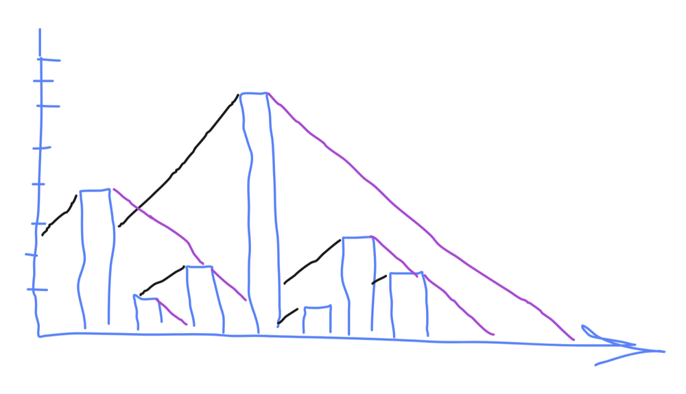

# Cast 45deg shadow

**Author:** knotri
**Votes:** 2
**Link:** [https://leetcode.com/problems/maximum-number-of-points-with-cost/solutions/5647875/](https://leetcode.com/problems/maximum-number-of-points-with-cost/solutions/5647875/)

---

# Intuition
Lets start with total brute force, for each row. For each cell in a row find maximum possible achived score so far.
1. Observe that for cell on row[x] we only need max score for cells on row[x-1], but it doesn't matter what happened on row[x-2]. So space optimization DP
2. However to find maximum possible score for cell, we need to check every cell on previus row. That will results in TLE.
3. To eliminate checking each cell on previus row, think about the case, when one cell has score of 100, and all close neightbor have score of 1. Its always better take 100, if distance is close enough.

Okay, so it should be intuitive, but we dont exactly have case with 100/1, and what is "close enough"? Its when tallest element taller then neightbor more then its far away. Everything with Taller > Farther is good. Its equal to cast a shadow with 45degree



Moving from left to right, if we see tallest element, start casting shadow from it, each next step reduce high of shadow by one. (Purple line on picture)

Then repeat the same process from right to left (Black line)


# Complexity
- Time complexity: $$O(3*n*m)$$ = $$O(n*m)$$
<!-- Add your time complexity here, e.g. $$O(n)$$ -->

- Space complexity: $$O(n)$$, 
<!-- Add your space complexity here, e.g. $$O(n)$$ -->

# Code
```
function maxPoints(grid: number[][]): number {
    let dp = []
    for(let el of grid[0]) {
        dp.push(el)
    }

    const shadow = (dp) => {
        let current = 0;
        for(let i = 0; i < dp.length; i++) {
            current--
            const el = dp[i]
            if (el > current) {
                current = el
            } else {
                dp[i] = current
            }
        }

        for(let i = dp.length - 1; i >= 0; i--) {
            current--
            const el = dp[i]
            if (el > current) {
                current = el
            } else {
                dp[i] = current
            }
        }
    }

    shadow(dp)

    for(let i = 1; i < grid.length; i++) {
        const newDp = []
        for(let j = 0; j < grid[i].length; j++) {
            newDp[j] = grid[i][j] + dp[j]
        }
        shadow(newDp)
        dp = newDp
    }

    return Math.max(...dp)
};
```