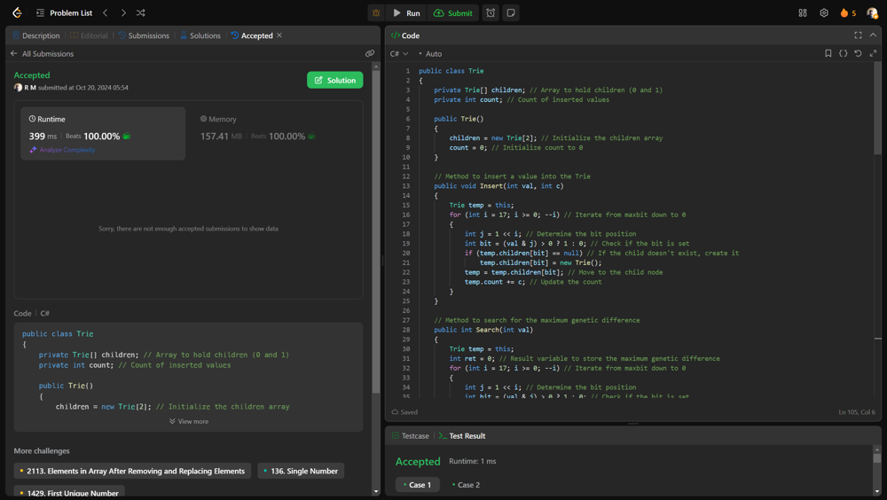

# 💥💥 Beats 100% on runtime and memory [EXPLAINED]

**Author:** r9n
**Votes:** 0
**Link:** [https://leetcode.com/problems/maximum-genetic-difference-query/solutions/5941727/](https://leetcode.com/problems/maximum-genetic-difference-query/solutions/5941727/)

---




# Intuition
Find the maximum genetic difference between a node and its descendants in a tree-like structure. This difference can be thought of as the largest value obtainable by flipping bits in the binary representation of node values. The goal is to efficiently calculate this maximum difference for a series of queries, which requires understanding the relationships between parent and child nodes.

# Approach
Use a Trie data structure to insert node values during a depth-first search (DFS) while maintaining a priority order of nodes; for each query, retrieve the maximum genetic difference by searching the Trie based on the given node values.

# Complexity
- Time complexity:
O(N + Q log Q + Q) where N is the number of nodes (for the DFS and Trie operations) and Q is the number of queries (for sorting and searching).

- Space complexity:
O(N) for the Trie and adjacency list storage.

# Code
```csharp []
public class Trie
{
    private Trie[] children; // Array to hold children (0 and 1)
    private int count; // Count of inserted values

    public Trie()
    {
        children = new Trie[2]; // Initialize the children array
        count = 0; // Initialize count to 0
    }

    // Method to insert a value into the Trie
    public void Insert(int val, int c)
    {
        Trie temp = this;
        for (int i = 17; i >= 0; --i) // Iterate from maxbit down to 0
        {
            int j = 1 << i; // Determine the bit position
            int bit = (val & j) > 0 ? 1 : 0; // Check if the bit is set
            if (temp.children[bit] == null) // If the child doesn't exist, create it
                temp.children[bit] = new Trie();
            temp = temp.children[bit]; // Move to the child node
            temp.count += c; // Update the count
        }
    }

    // Method to search for the maximum genetic difference
    public int Search(int val)
    {
        Trie temp = this;
        int ret = 0; // Result variable to store the maximum genetic difference
        for (int i = 17; i >= 0; --i) // Iterate from maxbit down to 0
        {
            int j = 1 << i; // Determine the bit position
            int bit = (val & j) > 0 ? 1 : 0; // Check if the bit is set
            // Check for the opposite bit in the Trie
            if (temp.children[1 - bit] != null && temp.children[1 - bit].count > 0)
            {
                ret |= j; // If exists, include this bit in the result
                temp = temp.children[1 - bit]; // Move to the opposite child
            }
            else if (temp.children[bit] != null && temp.children[bit].count > 0)
            {
                temp = temp.children[bit]; // Otherwise, continue down the same bit
            }
            else
            {
                return 0; // If neither child is available, return 0
            }
        }
        return ret; // Return the maximum genetic difference found
    }
}

public class Solution
{
    private int count = 0; // Counter for the topological sort
    private Trie root; // Root of the Trie
    private int[] priority = new int[100000]; // Array to store node priorities

    // Method to find maximum genetic differences based on parent-child relationships
    public int[] MaxGeneticDifference(int[] parents, int[][] queries)
    {
        int n = parents.Length; // Size of the parents array
        List<List<int>> adj = new List<List<int>>(n); // Adjacency list for the tree

        for (int i = 0; i < n; ++i)
            adj.Add(new List<int>()); // Initialize the adjacency list

        int u = -1; // Variable to store the root node index
        for (int i = 0; i < n; ++i)
        {
            if (parents[i] == -1)
                u = i; // Find the root node
            else
                adj[parents[i]].Add(i); // Build the adjacency list
        }

        TopologicalSort(u, adj, -1); // Perform topological sort

        // Append original indices to queries for sorting
        for (int i = 0; i < queries.Length; ++i)
        {
            Array.Resize(ref queries[i], queries[i].Length + 1); // Resize each query
            queries[i][^1] = i; // Add the index to the last position
        }

        // Sort queries based on the node priorities
        Array.Sort(queries, (a, b) => priority[a[0]].CompareTo(priority[b[0]]));

        int[] ret = new int[queries.Length]; // Initialize the result array
        root = new Trie(); // Create a new Trie
        int j = 0; // Initialize query index
        Dfs(u, adj, ref j, ret, queries, -1); // Perform DFS to answer queries
        return ret; // Return the result array
    }

    // Topological sort function
    private void TopologicalSort(int u, List<List<int>> adj, int parent)
    {
        priority[u] = count++; // Assign priority and increment counter
        foreach (int v in adj[u]) // Iterate through each child
            if (v != parent) // Avoid traversing back to the parent
                TopologicalSort(v, adj, u); // Recursively sort the subtree
    }

    // DFS function to handle queries and insertions into the Trie
    private void Dfs(int u, List<List<int>> adj, ref int j, int[] ret, int[][] queries, int parent)
    {
        root.Insert(u, 1); // Insert the current node into the Trie
        while (j < queries.Length && u == queries[j][0]) // Check for matching queries
        {
            ret[queries[j][2]] = root.Search(queries[j][1]); // Perform search in Trie
            j++; // Move to the next query
        }
        foreach (int v in adj[u]) // Iterate through children
            if (v != parent) // Avoid traversing back to the parent
                Dfs(v, adj, ref j, ret, queries, u); // Recursive DFS call
        root.Insert(u, -1); // Remove the current node from the Trie
    }
}

```