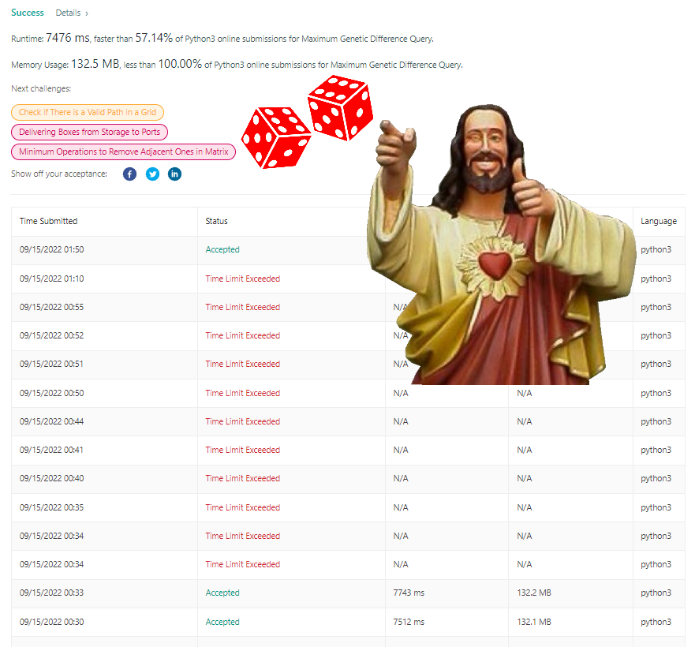

# [Python] May the RNGesus be with you!!!

**Author:** SotheanithSok
**Votes:** 1
**Link:** [https://leetcode.com/problems/maximum-genetic-difference-query/solutions/2578808/](https://leetcode.com/problems/maximum-genetic-difference-query/solutions/2578808/)

---



**Solution**:
Use trie tree and dfs to solve this problem. Start by building an adjacency list mapped all nodes to their child and a queries dict mapped nodes to their values. Preserve the orignal position of each query so that we return the correct order of results. In order to avoid sorting results, we will use an ordered dict mapped queries position to their results.

Start dfs through all nodes starting from the root. For each node, add it into a trie tree and calculate results of queries correspond to such node. Then, dfs through its child before removing such node from the trie tree and backtracking. 

Finally, pray that leetcode will accept your code.

Optimization Performed:
1. Dynamic depth for Trie tree
2. Use OrderedDict to avoid sorting results
3. Iterative DFS
4. Trie tree pruning using sets for quicker find and remove. It is actually run slower because we have to maintain sets for every node in the trie tree.

**Complexity**:
    Time: O(m n) where is m is the number of node and n is the number of queries
    Space: O (m + n)
	
```
from collections import OrderedDict, defaultdict

#Trie tree with no pruning 
class TrieNode:

    # Instantiate a trie node of a fix bits length
    def __init__(self, bits=0) -> None:

        # A dict mapped this trie node to its child trie nodes
        self.children = defaultdict(TrieNode)

        # A variable to keep track of the bits length starting from this node
        self.bits = bits

        # A variable to store the value correspond to bits starting from the root to this node
        self.val = None

    # Add a value into the trie node
    def add(self, val):

        # Intialize the current node
        node = self

        # Iterate through all bits of the value starting from the most significant bit
        for offset in range(self.bits - 1, -1, -1):

            # Find the current bit
            bit = (val & 1 << offset) >> offset

            # Continue to the next node based on the current bit
            node = node.children[bit]

        # Save the value at the last node
        node.val = val

    # Given a value, find an existing value in the trie node such that both values xor to the largest possible value
    def find(self, val):

        # Initialize the current node
        node = self

        # Iterate through all bits of the value starting from the most significant bit
        for offset in range(self.bits - 1, -1, -1):

            # Find the current bit
            bit = (val & 1 << offset) >> offset

            # If there exists a trie node correspond to the opposite of the current bit, go there
            # Else, go to the trie node correspond to the current bit
            node = (
                node.children[1 - bit]
                if 1 - bit in node.children
                else node.children[bit]
            )

        # Return the value of the last node
        return node.val

    # Remove a value from the trie node
    def remove(self, val):

        # DFS through the trie node
        def dfs(offset, node):

            # Stop the search once we reach -1 bit
            if offset == -1:
                return

            # Find the current bit
            bit = (val & 1 << offset) >> offset

            # Go to the child trie node base on the current bit
            dfs(offset - 1, node.children[bit])

            # If the child trie node has no children, remove the such node from the current node
            if len(node.children[bit].children) == 0:
                node.children.pop(bit)

        # Call dfs starting on the root
        dfs(self.bits - 1, self)


class Solution:
    def maxGeneticDifference(
        self, parents: list[int], queries: list[list[int]]
    ) -> list[int]:

        # Find the number of nodes and queries
        m, n = len(parents), len(queries)

        # Build an adjacency list
        root, adj = None, defaultdict(list)
        for dst, src in enumerate(parents):
            if src == -1:
                root = dst
                continue
            adj[src].append(dst)

        # Create a dict mapped nodes to their queries positions and values
        query = defaultdict(list)
        for i, (node, val) in enumerate(queries):
            query[node].append((i, val))

        # Intialize an OrderedDict to store the result
        res = OrderedDict({i: -1 for i in range(n)})

        # Intialize the trie node
        trie = TrieNode(m.bit_length())

        # Iterative DFS
        # Initalize a stack and a list of keep track of previous nodes
        stack, previous = [(-1, root)], []

        # Iterate until the stack is empty
        while stack:

            # Pop a node from the stack
            parent, node = stack.pop()

            # If the parent of the current node is not the last node in the list of previous nodes
            while previous and previous[-1] != parent:

                # Pop it from the list and remove such node from the trie node
                trie.remove(previous.pop())

            # Add the current node to the trie node
            trie.add(node)

            # Append the current node to the list of previous nodes
            previous.append(node)

            # Calculate queries correspond to the current node
            for i, val in query[node]:
                res[i] = trie.find(val) ^ val

            # Add the child of the current node onto the stack
            for nextNode in adj[node]:
                stack.append((node, nextNode))

        # Return results as a list
        return list(res.values())
```


```
#Trie tree with pruning using set for quicker find and remove.
class TrieNode:

    # Instantiate a trie node of a fix bits length
    def __init__(self, bits=0) -> None:

        # A dict mapped this trie node to its child trie nodes
        self.children = defaultdict(TrieNode)

        # A variable to keep track of the bits length starting from this node
        self.bits = bits

        # A variable to store values correspond to this bit
        self.vals = defaultdict(set)

    # Add a value into the trie node
    def add(self, val):

        # Intialize the current node
        node = self

        # Iterate through all bits of the value starting from the most significant bit
        for offset in range(self.bits - 1, -1, -1):

            # Find the current bit
            bit = (val & 1 << offset) >> offset

            # Add the value to the current bit
            node.vals[bit].add(val)

            # Continue to the next node based on the current bit
            node = node.children[bit]

    # Given a value, find an existing value in the trie node such that both values xor to the largest possible value
    def find(self, val):

        # Initialize the current node
        node = self

        # Iterate through all bits of the value starting from the most significant bit
        for offset in range(self.bits - 1, -1, -1):

            # Find the current bit
            bit = (val & 1 << offset) >> offset

            # If there is one value correspond to the opposite bit, return such value
            if 1 - bit in node.children and len(node.vals[1 - bit]) == 1:
                return list(node.vals[1 - bit])[0]

            # Else, if there is no value correspond to the opposite bit but there is a single value correspond to the current bit, return such value
            elif len(node.vals[1 - bit]) == 0 and len(node.vals[bit]) == 1:
                return list(node.vals[bit])[0]

            # If there exists a trie node correspond to the opposite of the current bit, go there
            # Else, go to the trie node correspond to the current bit
            node = (
                node.children[1 - bit]
                if 1 - bit in node.children
                else node.children[bit]
            )

    # Remove a value from the trie node
    def remove(self, val):

        # Initialize the current node
        node = self

        # Iterate through all bits of the value starting from the most significant bit
        for offset in range(self.bits - 1, -1, -1):

            # Find the current bit
            bit = (val & 1 << offset) >> offset

            # Remove the value from the current bit
            node.vals[bit].remove(val)

            # If there is no value correspond to the current bit, pop the node correspond to such bit from the children of the current node
            if len(node.vals[bit]) == 0:
                node.children.pop(bit)
                return

            # Else, go to the next node based on the current bit
            node = node.children[bit]
```