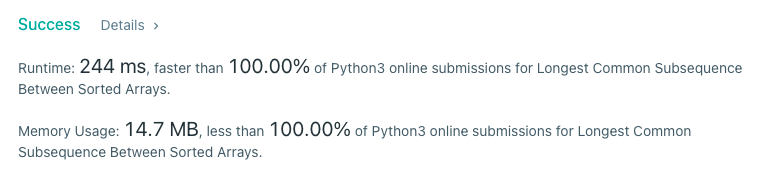

# Python  Solution Beats 100% time 100% space

**Author:** prajwal_vs
**Votes:** 6
**Link:** [https://leetcode.com/problems/longest-common-subsequence-between-sorted-arrays/solutions/1357442/](https://leetcode.com/problems/longest-common-subsequence-between-sorted-arrays/solutions/1357442/)

---

```
class Solution:
    def longestCommomSubsequence(self, arrays: List[List[int]]) -> List[int]:
        data={}
        n=len(arrays)
        for idx in range(n):
            for ele in arrays[idx]:
                if ele not in data:
                    data[ele]=0
                data[ele]+=1
        return [i for i in data.keys() if data[i]==n]
```


