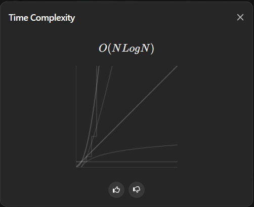
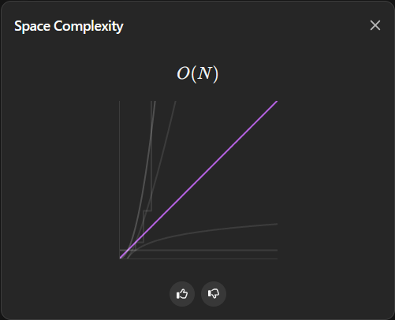

# PHP moment

**Author:** romka3214
**Votes:** 0
**Link:** [https://leetcode.com/problems/the-number-of-the-smallest-unoccupied-chair/solutions/5900665/](https://leetcode.com/problems/the-number-of-the-smallest-unoccupied-chair/solutions/5900665/)

---

# Intuition
I'll be honest, I just solved the problem. I have no idea what algorithm I used; in my mind, it's just a simple brute force. And I don't believe my solution has a time complexity of O(N logN) and O(n) space complexity, as that's what leetCode told me.

# Approach





# Complexity
- Time complexity:
O(N logN)

- Space complexity:
O(n)

# Code
```php []
class Solution {

    /**
     * @param Integer[][] $times
     * @param Integer $targetFriend
     * @return Integer
     */
    function smallestChair($times, $targetFriend) {
        $takenSeats = [];
        $leavedSeats = [];

        $arrivals = [];
        $leavings = [];

        foreach($times as $friendNum => $arriveLeave)
        {
            $arrivals[$arriveLeave[0]][] = $friendNum;
            $leavings[$arriveLeave[1]][] = $friendNum;
        }
      
        $timeline = $arrivals + $leavings;
        ksort($timeline);
    
        foreach($timeline as $time => $doNotUse)
        {
            if(isset($leavings[$time]))
            {
                foreach($leavings[$time] as $friendNum)
                {
                    $leavedSeat = $takenSeats[$friendNum];
                    unset($takenSeats[$friendNum]);
                    $leavedSeats[$leavedSeat] = true;
                    ksort($leavedSeats);
                }
                
            }

            if(isset($arrivals[$time]))
            {
                $break = false;
                foreach($arrivals[$time] as $friendNum)
                {
                    if(empty($leavedSeats))
                    {
                        $takenSeats[$friendNum] = count($takenSeats);
                    } else{
                        $takenSeats[$friendNum] = array_key_first($leavedSeats);
                        unset($leavedSeats[array_key_first($leavedSeats)]);
                    }
                    if($friendNum == $targetFriend){
                        $break = true;
                        break;
                    }
                }
                if($break){
                    break;
                }
            }
        }
        return $takenSeats[$targetFriend];
    }
}
```