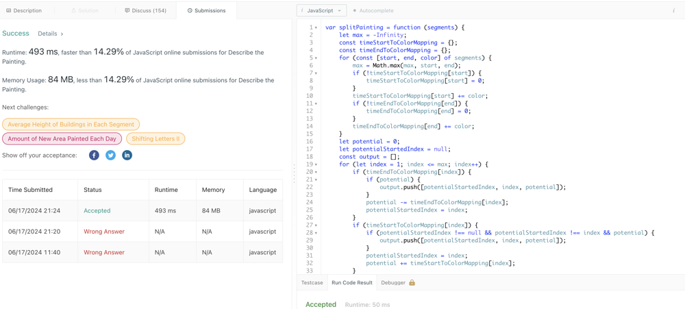
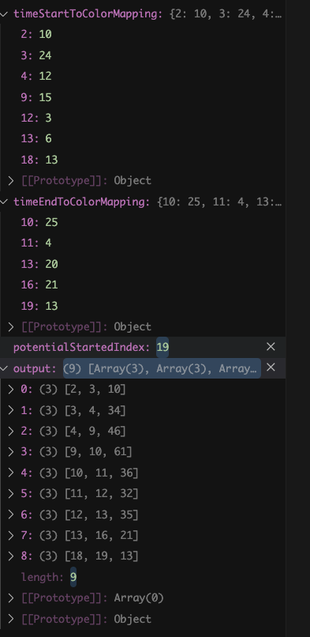

# ❇ describe-the-painting Images👌 🏆O(N)❤️ Javascript🎯 Memory👀14.29%🕕 ++Explanation✍️🔴🔥✅💪🙏👉

**Author:** anurag-sindhu
**Votes:** 2
**Link:** [https://leetcode.com/problems/describe-the-painting/solutions/5328192/](https://leetcode.com/problems/describe-the-painting/solutions/5328192/)

---

Time Complexity: O(N)
Space Complexity: O(N)
```
var splitPainting = function (segments) {
    let max = -Infinity;
    const timeStartToColorMapping = {};
    const timeEndToColorMapping = {};
    for (const [start, end, color] of segments) {
        max = Math.max(max, start, end);
        if (!timeStartToColorMapping[start]) {
            timeStartToColorMapping[start] = 0;
        }
        timeStartToColorMapping[start] += color;
        if (!timeEndToColorMapping[end]) {
            timeEndToColorMapping[end] = 0;
        }
        timeEndToColorMapping[end] += color;
    }
    let potential = 0;
    let potentialStartedIndex = null;
    const output = [];
    for (let index = 1; index <= max; index++) {
        if (timeEndToColorMapping[index]) {
            if (potential) {
                output.push([potentialStartedIndex, index, potential]);
            }
            potential -= timeEndToColorMapping[index];
            potentialStartedIndex = index;
        }
        if (timeStartToColorMapping[index]) {
            if (potentialStartedIndex !== null && potentialStartedIndex !== index && potential) {
                output.push([potentialStartedIndex, index, potential]);
            }
            potentialStartedIndex = index;
            potential += timeStartToColorMapping[index];
        }
    }
    return output;
};
```

For Input:
```
[[4, 16, 12], [9, 10, 15], [18, 19, 13], [3, 13, 20], [12, 16, 3], [2, 10, 10], [3, 11, 4], [13, 16, 6]]
```



