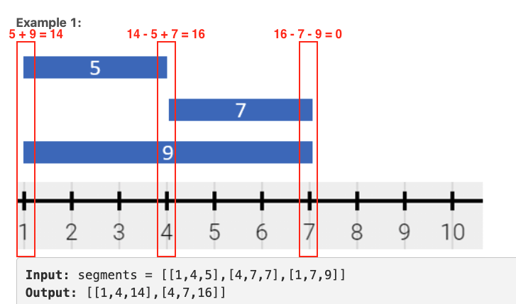
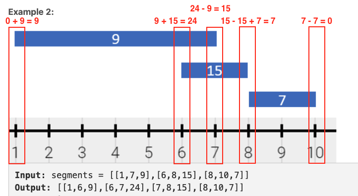

# [Python] Easy solution in O(n*logn) with detailed explanation

**Author:** fishballLin
**Votes:** 143
**Link:** [https://leetcode.com/problems/describe-the-painting/solutions/1359717/](https://leetcode.com/problems/describe-the-painting/solutions/1359717/)

---

### Idea
we can iterate on coordinates of each `[start_i, end_i)` from small to large and maintain the current mixed color.

### How can we maintain the mixed color?
We can do addition if the current coordinate is the beginning of a segment.
In contrast, We do subtraction if the current coordinate is the end of a segment.

### Examples
Let's give the example for understanding it easily.

#### Example 1:


There are 3 coordinates get involved. 1, 4, 7 respetively.
At coordinate 1, there are two segment starting here. Thus, the current mixed color will be 5 + 9 = 14
At coordinate 4, the segment [1, 4, 5] is end here and the segment [4, 7, 7] also start here. Thus, the current mixed color will be 14 - 5 + 7 = 16
At coordinate 7, two segments are end here. Thus, the current mixed color will be 0
So we know the final answer should be [1, 4, 14] and [4, 7, 16].


#### Example 2:


There are 5 coordinates get involved. 1, 6, 7, 8, 10 respetively.
At coordinate 1, only the segment [1, 7, 9] start here. Thus, the current mixed color will be 0 + 9 = 9
At coordinate 6, another segment [6, 8, 15] start here. Thus, the current mixed color will be 9 + 15 = 24
At coordinate 7, the segment [1, 7, 9] is end here. Thus, the current mixed color will be 24 - 9 = 15
At coordinate 8, the segment [6, 8, 15] is end here and the segment [8, 10, 7] also start here. Thus, the current mixed color will be 15 - 15 + 7 = 7
At coordinate 10, the segment [8, 10, 7] is end here. Thus, the current mixed color will be 0
So we know the final answer should be [1,6,9], [6,7,24], [7,8,15], [8,10,7].

### Complexity
- Time complexity: O(n * log(n)) # We can use a fixed size array with length 10^5 to replace the default dict and bound the time complexity to O(n).
- Space complexity: O(n)

### Code

```python
class Solution:
    def splitPainting(self, segments: List[List[int]]) -> List[List[int]]:
		# via this mapping, we can easily know which coordinates should be took into consideration.
        mapping = defaultdict(int)
        for s, e, c in segments:
            mapping[s] += c
            mapping[e] -= c
        
        res = []
        prev, color = None, 0
        for now in sorted(mapping):
            if color: # if color == 0, it means this part isn't painted.
                res.append((prev, now, color))
            
            color += mapping[now]
            prev = now
            
        return res
```

Please upvote if it's helpful or leave comments if I can do better. Thank you in advance.
