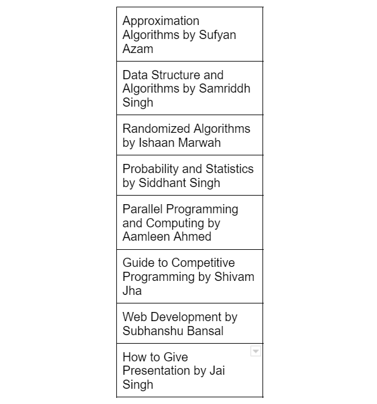
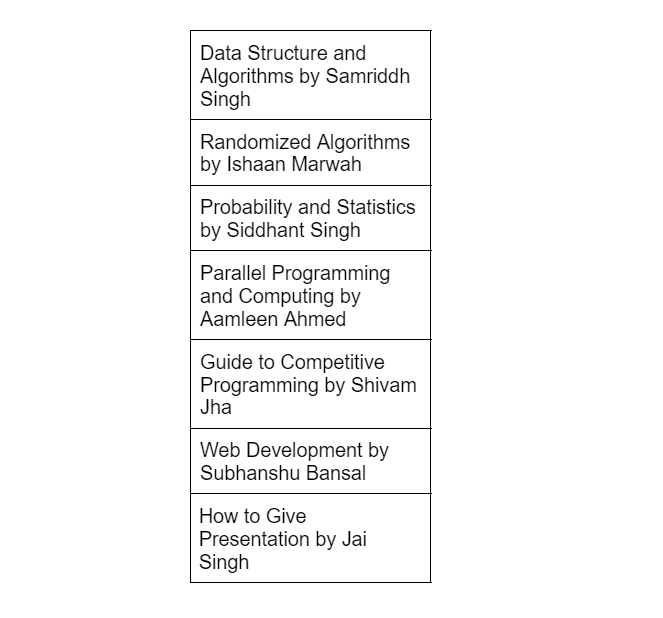
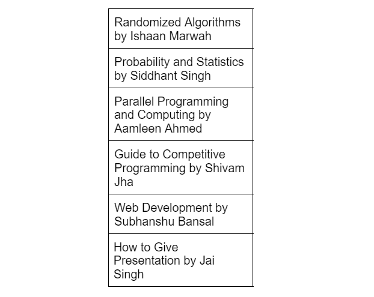

# Number of Visible People in a Queue  Using Monotonic Stack in C++ ( Detailed Explanation :) )

**Author:** js0657096
**Votes:** 25
**Link:** [https://leetcode.com/problems/number-of-visible-people-in-a-queue/solutions/3424402/](https://leetcode.com/problems/number-of-visible-people-in-a-queue/solutions/3424402/)

---

# Preliminaries 
In the given Problem, I use a "Stack" data structure. Let's quickly revise the Stack data structure by going through some of the basic terminologies related to the stack, and then we can start with the intuition and approach  I use to solve the Given Problem :).
**PS : I Will Discuss C++ STL Stack**

- **Basic definition**
**(i) Stack** : container adapter which follows **LIFO( Last In First Out)** principle. on the other hand Queue follows **FIFO( First In First Out)** principle.for a better understanding consider a scenario where there is a stack of books and you want a particular book , so to get your favourite you first need to remove the books that are placed at the top of the stack then only you will your favourite book.
for the Queue let's consider scenario of a shop where buyers come to purchase item but before purchasing the item , they have to stand in a queue and when their chance come they will do their purchase.those customer who come first in the queue will do the purchase first. 
so from above two real life example you can differentiate between Stack and Queue. I Hope you will understand both ( at least their basic defination ).
**Example**
for a better understanding let's understand stack with images and a real life example.

Let's Consider we have a stack of books in the below Image Order :
 


Now the User is Interested in Reading **Randomized Algorithms by Ishaan Marwah** but we observe that the user can't access the "Randomized Algorithms by Ishaan Marwah" directly.first the user need to remove the **Approximation Algorithms by Sufyan Azam** and then **Data Structure by Samriddh Singh** 

First the User Remove/pop the **Approximation Algorithms by Sufyan Azam** and after popping/removing the top element.Our Stack of Books Looks like the Below Image : 



Now, Again the User Remove/pop book placed at the top of the stack 
**Data Structure by Samriddh Singh** and our stack of book look like below image : 


Now Finally :) the User can pick the topmost book which is the book he wants. 

in the Same Way , Stack Data Structure Works.

PS : Names used in the Above Example is Fictious and any similarity is Completely Coincidal.

- **Basic Operation in Stack (C++ STL Stack is Discussed Below )**

**(1)Stack Syntax**

(i) Syntax :  template <class Type, class Container = deque<Type> > class stack;

(a) Type :  is the Type of element contained in the std::stack.
(b) Container \u2013 is the Type of underlying container object.

Example :in C++ STL , to intialize a stack of integer 
```
stack<int> st;
```  
it initilize a stack of integer.

**(2) Stack functions**

**(i) empty()**
(a) returns Whether the stack is empty or not.
(b) Time Complexity - O(1).

**(ii) size()**
(a) returns the size of the stack.
(b) Time Complexity - O(1).

**(iii) top()**
(a) returns a reference to the topmost element of the stack.
(b) Time Complexity - O(1).


**(iv) push(g)**
(a) adds the element 'g' at the top of the stack.
(b) Time Complexity - O(1).

**(v) pop()**
(a) removes the top-most element of the stack.
(b) Time Complexity - O(1).

```

/*If You Don't Know Anything About Stack Just Copy this Code and 
/*Run on Your IDE. you will understand basic operation of stack and*/
/* if you have any doubt comment it down , I Will Help for Sure !!! :) */

include <iostream>
#include <stack>
using namespace std;

void show_stack_opr(){
    stack<int> st;
    st.push(5);
    st.push(6);
    st.push(7);
    st.push(8);
    st.push(9);
    cout<<"Size "<<st.size()<<endl;
    /* Output : 5 */
    while(!st.empty()){
        int topi=st.top();
        cout<<topi<<" ";
        st.pop();
    }
    cout<<endl;
    /*Output : 9 8 7 6 5*/

}

int main(){
    show_stack_opr();
    return 0;
}
```


# Intuition
<!-- Describe your first thoughts on how to solve this problem. -->
To Solve the Given Problems , First Thing Comes in my mind is that for the last element the answer should be zero and then from last we can iterates over the h vector and checking some condition we will arrive at our solution. more is explained in the Approach section , here i only explain the first thought come in my mind when i start solving the problem in my notebook.

# Approach
<!-- Describe your approach to solving the problem. -->

(i) the function "canSeePersonsCount" takes in vector<int> h as the argument which contains the height of group of peoples standing in a line.

(ii) we implement a stack based algorithm , that starts by initializing a empty stack and pushing the height of the last person in the line to the stack.

(iii) For Each Person h[i] in the line , first we check if there is any taller people to the right of h[i] by popping elements off the stack untill it either finds a taller people or the stack becomes empty.

(iv) for each popped element the algorithm increment a counter num to keep track of how many people were popped off the stack and if the stack is not empty after the popping element , this means that there is atleast one person people taller than h[i] and num is increment one more time.

(v) the height of ith person pushed into the stack and num is stored at the ith position of the ans array.

(vi) we return the ans , in which for ith index contain the number of person ith person can to their right.


# Complexity
- Time complexity : O(n).
where n is the number of elements in the input vector h. This is because the algorithm iterates through the input vector once, and for each element, it performs a constant number of stack operations.
{ Each Stack Operation Takees O(1) Time. }

- Space complexity: O(n).
<!-- Add your space complexity here, e.g. $$O(n)$$ -->
the algorithm uses a stack to store at most n elements, where n is the number of elements in the input vector h. Additionally, the algorithm uses a vector ans to store the results, which also has a size of n. Therefore, the total space used by the algorithm is proportional to the size of the input vector h, which makes the space complexity O(n).

# Code
```
class Solution {
public:
    vector<int> canSeePersonsCount(vector<int>& h) {

        int size=h.size();
        vector<int> ans(size,0);
        stack<int> st;
        st.push(h[size-1]);

        for(int i=size-2;i>=0;i--){

            int num=0;

            while(!st.empty() && st.top()<h[i]){
                st.pop();
                num++;
            }

            if(!st.empty()){
                num++;
            }

            st.push(h[i]);
            ans[i]=num;

        }

        return ans;

    }
};
```

# Some More Interesting Problems on Stack 
(a) [https://leetcode.com/problems/minimum-remove-to-make-valid-parentheses/]()
(b) [https://leetcode.com/problems/check-if-a-parentheses-string-can-be-valid/description/]()
(c) [https://leetcode.com/problems/design-a-stack-with-increment-operation/]()
(d) [https://leetcode.com/problems/design-a-stack-with-increment-operation/]()
(e) [https://leetcode.com/problems/min-stack/]()

Happy Problem Solving :) 
Happy Coding :)

if you have any doubt , Please Comment  Will Help you for sure :) 


