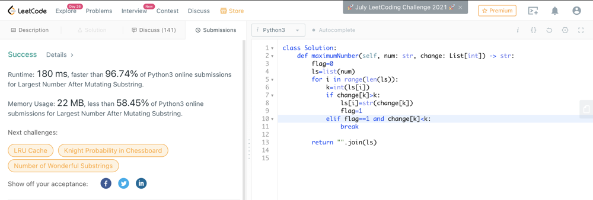

# Easy and fast Python3 O(n) beats 96%

**Author:** svr300
**Votes:** 6
**Link:** [https://leetcode.com/problems/largest-number-after-mutating-substring/solutions/1365030/](https://leetcode.com/problems/largest-number-after-mutating-substring/solutions/1365030/)

---

	class Solution:
    def maximumNumber(self, num: str, change: List[int]) -> str:
        flag=0
        ls=list(num)
        for i in range(len(ls)):
            k=int(ls[i])
            if change[k]>k:
                ls[i]=str(change[k])
                flag=1
            elif flag==1 and change[k]<k:
                break
        
        return "".join(ls)

