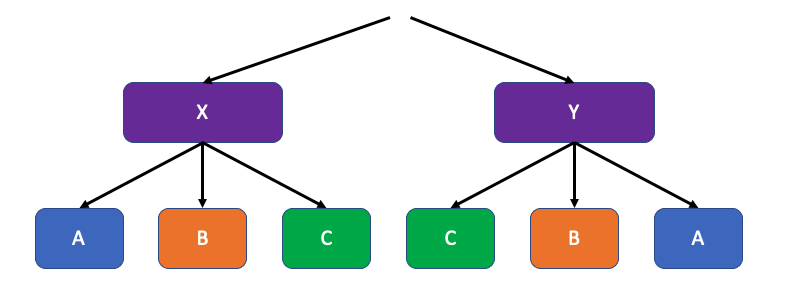
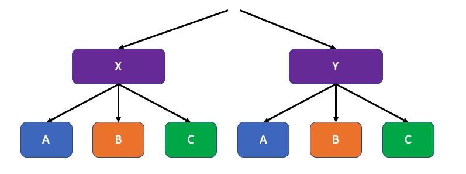
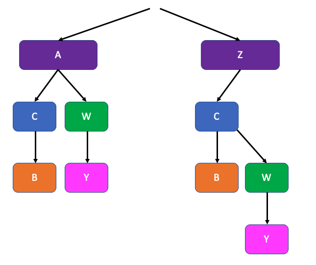

# Good and Naively bad hashes: analysis

**Author:** optimizeMyDay
**Votes:** 2
**Link:** [https://leetcode.com/problems/delete-duplicate-folders-in-system/solutions/2201281/](https://leetcode.com/problems/delete-duplicate-folders-in-system/solutions/2201281/)

---

If you went through a number of solutions, you'll notice that they mostly use the same hash for a folder:

```
 "(" + "".join(folder + serialize(s) for s in subfolders) + ")"
 ```
 
 However, if you previously solved [Find duplicate subtrees](https://leetcode.com/problems/find-duplicate-subtrees/), you'll know that in that case, we were dealing with binary trees (rather than n-ary like here) and the serialisation for a node could look like:
 
 ```
str(node.val) + serialize(node.left) + serialize(node.right)
 ```
 or
 ```
 serialize(node.left) + "," + serialialize(node.right) + "," + str(node.val)
 ```
 
 or really any other combo of simply appending serialization of 2 children to the node value itself.

**So what's different now?**

 
1.  We have multiple children and we cannot trust that the input will be sorted for us. Since we are keeping subfolders/children in a hashmap, the order of keys is not guaranteed

for input like
```
[['x'], ['y']      ['x','a'], ['x','b'], ['x','c'],    ['y','c'], ['y','b'], ['y','a']]
```
If 'x' has a serialisation of ('abc') and 'y' will have ('cba'), then we will miss the case 



even though the two folders are clearly duplicates




that means that *as you are building* the Tree/Node/Trie, you could sort the paths list first\u044E

2. Why do we add parentheses?

I decided not to add them and failed on this test case:



We can see that they are pretty different, but without parentheses, here are:

serialisation of A:

```
C + serialize(C's children) + W + serialise(W's children) = C + B + W +Y = CBWY
```


serialisation of Z:

```
C + serialize(C's children)  = C + B + W + serialize(W's children) = C + B + W + Y = CBWY
```


But in realiaty they are more like
```
[C->B][W->Y]
```
and 
```
C->[B][W->Y]
```
or any other groupping you can come up with to distinguish the different subtrees.
