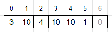
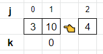
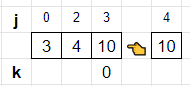
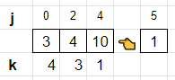
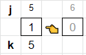

# Monostack with pictures

**Author:** votrubac
**Votes:** 36
**Link:** [https://leetcode.com/problems/maximum-of-minimum-values-in-all-subarrays/solutions/1373739/](https://leetcode.com/problems/maximum-of-minimum-values-in-all-subarrays/solutions/1373739/)

---

My first thought was monostack, but the implementation was super tricky for me.

> BTW, the first hint for this problem was helpful to build intuition, but the others just confused me.

For simplicity, we add zero to the end of the array (sentinel). For the explanation below, we will be using this example:



We maintain the monotonically increased stack. It's important to know the position of elements in that stack, so instead of values we will store indexes (we can lookup values using the input array). When we need to remove an element from the stack, we use indexes to compute the maximum query size that element is the potential maximum for.

For our example, the top of the stack - `10` - is the maximum for query `0` (`2 - 1 - (0 + 1)`).


Keep going; `10` is on the top again and it is the maximum for query `0` (`(4 - 1) - (2 + 1)`).



Now this is interesting:
- `10` is the maximum for query `1` (`(5 - 1) - (2 + 1)`).
- `4` is the maximum for query `3` (`(5 - 1) - (0 + 1)`).
- `3` is the maximum for query `4` (`5 - 1 - 0`)



Finally, we process our sentinel value to empty the stack and compute maximums. For our example, `1` is the maximum for query `5`.



Since we compute the maximum query size, we can have gaps. We fill these gaps in the end, making sure that the result array in non-decreasing right-to-left. 

**C++**
```cpp
vector<int> findMaximums(vector<int>& n) {
    vector<int> res(n.size()), s;
    n.push_back(0);
    for (int i = 0; i < n.size(); ++i) {
        while (!s.empty() && n[s.back()] >= n[i]) {
            int j = s.back(), k = i - 1;
            s.pop_back();
            if (!s.empty())
                k -= s.back() + 1;
            res[k] = max(res[k], n[j]);
        }
        s.push_back(i);
    }
    for (int i = res.size() - 1; i > 0; --i)
        res[i - 1] = max(res[i - 1], res[i]);
    return res;
}
```
**Java**
```java
public int[] findMaximums(int[] n) {
    int[] res = new int[n.length];
    Stack<Integer> s = new Stack<>();
    for (int i = 0; i <= n.length; ++i) {
        while (!s.empty() && (i == n.length || n[s.peek()] >= n[i])) {
            int j = s.pop(), k = i - 1;
            if (!s.empty())
                k -= s.peek() + 1;
            res[k] = Math.max(res[k], n[j]);
        }
        s.push(i);
    }    
    for (int i = res.length - 1; i > 0; --i)
        res[i - 1] = Math.max(res[i - 1], res[i]);    
    return res;
}
```