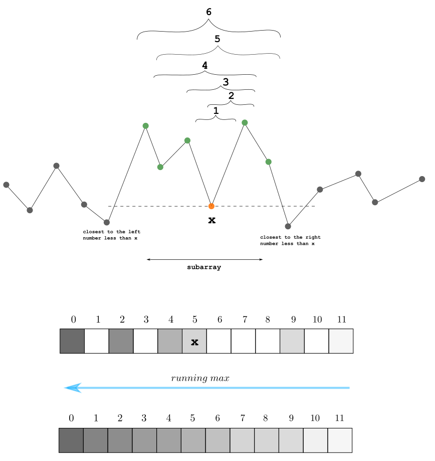

# monotonic stack+running max ^^

**Author:** andrii_khlevniuk
**Votes:** 0
**Link:** [https://leetcode.com/problems/maximum-of-minimum-values-in-all-subarrays/solutions/5467833/](https://leetcode.com/problems/maximum-of-minimum-values-in-all-subarrays/solutions/5467833/)

---

**4 pass**
**time: `O(N)`; space: `O(N)`**



The problem uses [2832.Maximal Range That Each Element Is Maximum in It](https://leetcode.com/problems/maximal-range-that-each-element-is-maximum-in-it/) as a subproblem. It could be solved with it two slightly different ways. One of them leads to
```
vector<int> findMaximums(vector<int>& n)
{
	vector d(size(n), 0);
	stack<int> st{{-1}};
	for(int i{}; i<size(n); ++i)
	{
		for( ; size(st)>1 and n[st.top()]>=n[i]; st.pop());
		d[i] += i-st.top();
		st.push(i);
	}

	stack<int> st1{{int(size(n))}};
	for(int i(size(n)-1); i>=0; --i)
	{
		for( ; size(st1)>1 and n[st1.top()]>=n[i]; st1.pop());
		d[i] += st1.top()-i-1;
		st1.push(i);
	}
	vector out(size(n), 0);   
	for(int i{}; i<size(n); ++i)
		out[d[i]-1] = max(out[d[i]-1], n[i]); 

	for(int i(size(n)-2); i>=0; --i)
		out[i] = max(out[i], out[i+1]);
	return out;
}
```
The running max algo works because 
* we enumerate all minima and register them at the maximum subarray length;
* if `m` is one of the minima for subarrays of length 'l' it's also one of the minima for subarrays of length less than 'l'.

It's possible to come up with the solution that uses 1 pass and 1 stack to find [Maximal Range That Each Element Is Maximum in It](https://leetcode.com/problems/maximal-range-that-each-element-is-maximum-in-it/) that leads to 2 pass solution:

**2 pass**
**time: `O(N)`; space: `O(N)`**

```
vector<int> findMaximums(vector<int>& n)
{
	vector out(size(n), 0); 
	stack<int> s{{-1}};
	n.push_back(0);
	for(int i{}; i<size(n); ++i)
	{
		for( ; size(s)>1 and n[s.top()]>=n[i]; )
		{
			auto t = s.top(); s.pop();     
			auto ind = i-s.top()-1;
			out[ind-1] = max(out[ind-1], n[t]);    
		}
		s.push(i);
	}

	for(int i(size(out)-2); i>=0; --i)
		out[i] = max(out[i], out[i+1]);
	return out;
}
```