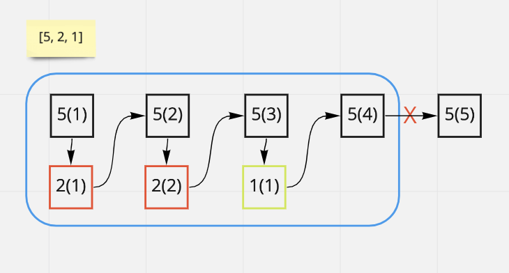
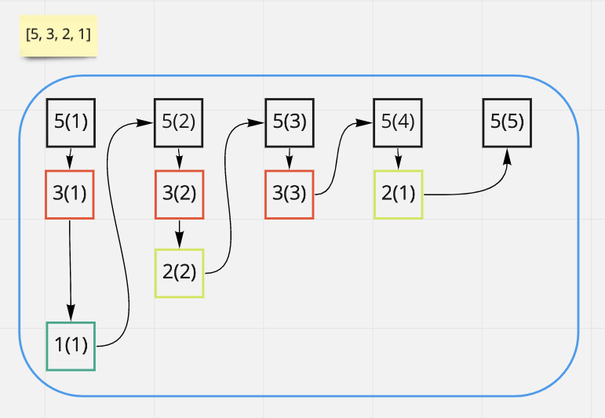
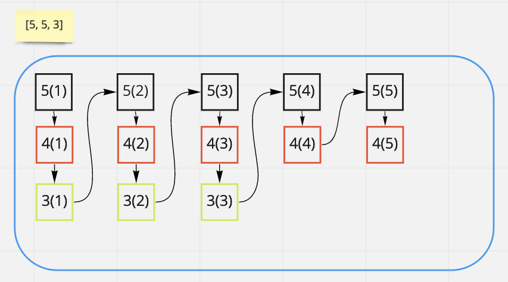

# [Python] Solution with detailed explanation & proof & common failure analysis

**Author:** fishballLin
**Votes:** 252
**Link:** [https://leetcode.com/problems/maximum-number-of-weeks-for-which-you-can-work/solutions/1375390/](https://leetcode.com/problems/maximum-number-of-weeks-for-which-you-can-work/solutions/1375390/)

---


## Solution 1
Thanks [@pgthebigshot](https://leetcode.com/pgthebigshot/) for providing another solution for easier understanding. 
I make some images to explain the idea.

### Idea
We can separate projects to two sets.
1. The project with the most milestones
2. The rest of the projects.

If `sum(milestones except the max)) = sum(milestones) - max(milestones)` < `max(milestones)`, we can only finish `2 * (sum(milestones) - max(milestones)) + 1` milestones.


Else, we can finish all milestones.


There is a edge case that if more than one project contains the same and the most milestones like [5, 5, 3], but we still be able to finish all of them.



## Solution 2
### Idea
If there are at least two projects with same number of milestones and there isn't a project with more milestones than that two, we can finish all milestones.
If not, we can only finish `2 * (sum(milestones) - max(milestones)) + 1` at most.

### Example
Let's say we have milestones like [5, 5, 3, 2].
We can take turn working on those projects with the most milestones.
So, [5, 5] will become [4, 4], then become [3, 3].
Because we have another project with 3 milestones, so we can take turn working on [3, 3, 3].
[3, 3, 3] after three rounds, will become [2, 2, 2].
[2, 2, 2, 2] -> [1, 1, 1, 1] -> [0, 0, 0, 0] -> all the milestones are finished

### What to do if no two projects with same number of milestones?
We can seperate projects to two parts: (1)project with most milestones (2)the rest of projects
The `greedy strategy` here is trying to use the milestones from (2) to form a new project with the same number of milestones as (1)
If possible, we can finish all milestones as we demonstrate.
If impossible, we can only start to work on the max (1)- > work on others (2) -> work on the max (1) -> etc

### Why the greedy strategy works?
Let's consider the case if n >= 3. (because if n == 1 -> only can finish 1, if n == 2, we can only take turn working on it and `_sum - _max` must < `_max` )
Let's say we have:
1. A max project with the most milestones: `p milestones`
2. A project with the second most milestones: `q milestones`
3. Rest of projects with `r milestones` in total

if `q + r >= p`  ( note: `q + r`  is the sum of milestones except the max project)
We can do `p-q` rounds, each round, we work on the max project first and the any one of the rest projects.
After one round, the milestones will be `p-1`, `q`, `r-1` respectively.
So after `p-q` rounds, the milestones will be `p-(p-q) = q`, `q`, `r-(p-q)` respectively.
Because the assumption of `q + r >= p`, `r-(p-q) ` will be larger or equal to 0, it's valid operations.  
Then we have two projects with `q`  milestones each and it means we can finish all the tasks (can refer to `Example` section)

## Code

```python
class Solution:
    def numberOfWeeks(self, milestones: List[int]) -> int:
        _sum, _max = sum(milestones), max(milestones)
		# (_sum - _max) is the sum of milestones from (2) the rest of projects, if True, we can form another project with the same amount of milestones as (1)
		# can refer to the section `Why the greedy strategy works?` for the proof
        if _sum - _max >= _max:  
            return _sum
        return 2 * (_sum - _max) + 1  # start from the project with most milestones (_sum - _max + 1) and work on the the rest of milestones (_sum - _max)
```

## Complexity
- Time complexity: O(n)
- Space complexity: O(1)

## Bonus
I noticed many people are trying to use priority queue to solve this problem, but there are two possible failed reasons.

1. Incorrect strategy
If you try to work on the top milestones and until one is all finished. Can consider the test case [100, 100, 100]. (Answer should be 300, but many will get 201 if using the wrong strategy)

2. TLE
If you always pick the top two milestones and reduce 1 milestones from each and put them back. Due to 1 <= n <= 10^5, 1 <= milestones[i] <= 10^9. In the worse case, you will need O(10^5 * 10^9 * log(10^5)))

Note: Please upvote if it's helpful or leave comments if I can do better. Thank you in advance.

