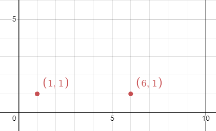
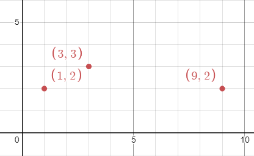

# [1956. Minimum Time For K Virus Variants to Spread](https://leetcode.com/problems/minimum-time-for-k-virus-variants-to-spread/)

| Category | Difficulty | Likes | Dislikes |
| :------: | :--------: | :---: | :------: |
| Algorithms | Hard | 32 | 7 |

**Tags:** [`array`](https://leetcode.com/tag/array), [`math`](https://leetcode.com/tag/math), [`binary-search`](https://leetcode.com/tag/binary-search), [`geometry`](https://leetcode.com/tag/geometry), [`enumeration`](https://leetcode.com/tag/enumeration)


## Description

There are `n` **unique** virus variants in an infinite 2D grid. You are given a 2D array `points`, where `points[i] = [x_i, y_i]` represents a virus originating at `(x_i, y_i)` on day `0`. Note that it is possible for **multiple **virus variants to originate at the **same** point.

Every day, each cell infected with a virus variant will spread the virus to **all **neighboring points in the **four** cardinal directions (i.e. up, down, left, and right). If a cell has multiple variants, all the variants will spread without interfering with each other.

Given an integer `k`, return *the **minimum integer** number of days for **any** point to contain **at least** *`k`* of the unique virus variants*.

 

**Example 1:**


```

Input: points = [[1,1],[6,1]], k = 2
Output: 3
Explanation: On day 3, points (3,1) and (4,1) will contain both virus variants. Note that these are not the only points that will contain both virus variants.

```

**Example 2:**


```

Input: points = [[3,3],[1,2],[9,2]], k = 2
Output: 2
Explanation: On day 2, points (1,3), (2,3), (2,2), and (3,2) will contain the first two viruses. Note that these are not the only points that will contain both virus variants.

```

**Example 3:**


```

Input: points = [[3,3],[1,2],[9,2]], k = 3
Output: 4
Explanation: On day 4, the point (5,2) will contain all 3 viruses. Note that this is not the only point that will contain all 3 virus variants.

```

 

**Constraints:**

	- `n == points.length`

	- `2 <= n <= 50`

	- `points[i].length == 2`

	- `1 <= x_i, y_i <= 100`

	- `2 <= k <= n`

---

**Links:** [Submissions](https://leetcode.com/problems/minimum-time-for-k-virus-variants-to-spread/) | [Solutions](https://leetcode.com/problems/minimum-time-for-k-virus-variants-to-spread/)
