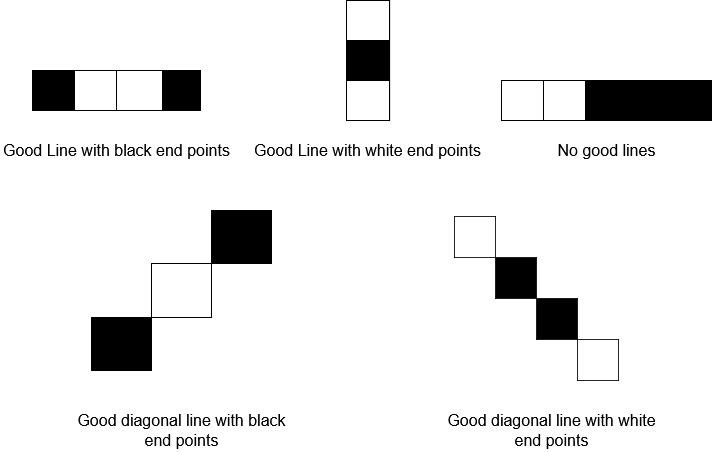
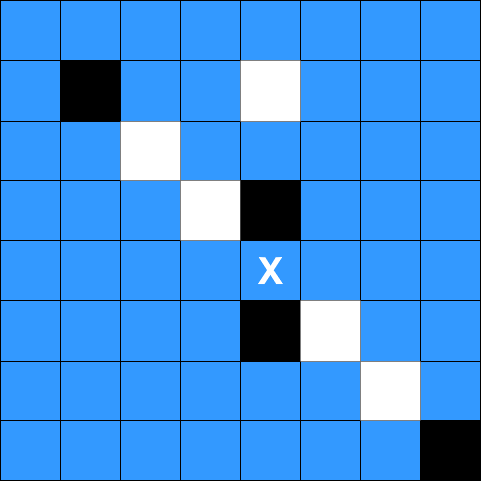

# [1958. Check if Move is Legal](https://leetcode.com/problems/check-if-move-is-legal/)

| Category | Difficulty | Likes | Dislikes |
| :------: | :--------: | :---: | :------: |
| Algorithms | Medium | 179 | 283 |

**Tags:** [`array`](https://leetcode.com/tag/array), [`matrix`](https://leetcode.com/tag/matrix), [`enumeration`](https://leetcode.com/tag/enumeration)

**Companies:** `amazon`

## Description

You are given a **0-indexed** `8 x 8` grid `board`, where `board[r][c]` represents the cell `(r, c)` on a game board. On the board, free cells are represented by `'.'`, white cells are represented by `'W'`, and black cells are represented by `'B'`.

Each move in this game consists of choosing a free cell and changing it to the color you are playing as (either white or black). However, a move is only **legal** if, after changing it, the cell becomes the **endpoint of a good line** (horizontal, vertical, or diagonal).

A **good line** is a line of **three or more cells (including the endpoints)** where the endpoints of the line are **one color**, and the remaining cells in the middle are the **opposite color** (no cells in the line are free). You can find examples for good lines in the figure below:



Given two integers `rMove` and `cMove` and a character `color` representing the color you are playing as (white or black), return `true` *if changing cell *`(rMove, cMove)` *to color* `color` *is a **legal** move, or *`false`* if it is not legal*.

 

**Example 1:**


```

Input: board = [[&quot;.&quot;,&quot;.&quot;,&quot;.&quot;,&quot;B&quot;,&quot;.&quot;,&quot;.&quot;,&quot;.&quot;,&quot;.&quot;],[&quot;.&quot;,&quot;.&quot;,&quot;.&quot;,&quot;W&quot;,&quot;.&quot;,&quot;.&quot;,&quot;.&quot;,&quot;.&quot;],[&quot;.&quot;,&quot;.&quot;,&quot;.&quot;,&quot;W&quot;,&quot;.&quot;,&quot;.&quot;,&quot;.&quot;,&quot;.&quot;],[&quot;.&quot;,&quot;.&quot;,&quot;.&quot;,&quot;W&quot;,&quot;.&quot;,&quot;.&quot;,&quot;.&quot;,&quot;.&quot;],[&quot;W&quot;,&quot;B&quot;,&quot;B&quot;,&quot;.&quot;,&quot;W&quot;,&quot;W&quot;,&quot;W&quot;,&quot;B&quot;],[&quot;.&quot;,&quot;.&quot;,&quot;.&quot;,&quot;B&quot;,&quot;.&quot;,&quot;.&quot;,&quot;.&quot;,&quot;.&quot;],[&quot;.&quot;,&quot;.&quot;,&quot;.&quot;,&quot;B&quot;,&quot;.&quot;,&quot;.&quot;,&quot;.&quot;,&quot;.&quot;],[&quot;.&quot;,&quot;.&quot;,&quot;.&quot;,&quot;W&quot;,&quot;.&quot;,&quot;.&quot;,&quot;.&quot;,&quot;.&quot;]], rMove = 4, cMove = 3, color = &quot;B&quot;
Output: true
Explanation: &#39;.&#39;, &#39;W&#39;, and &#39;B&#39; are represented by the colors blue, white, and black respectively, and cell (rMove, cMove) is marked with an &#39;X&#39;.
The two good lines with the chosen cell as an endpoint are annotated above with the red rectangles.

```

**Example 2:**


```

Input: board = [[&quot;.&quot;,&quot;.&quot;,&quot;.&quot;,&quot;.&quot;,&quot;.&quot;,&quot;.&quot;,&quot;.&quot;,&quot;.&quot;],[&quot;.&quot;,&quot;B&quot;,&quot;.&quot;,&quot;.&quot;,&quot;W&quot;,&quot;.&quot;,&quot;.&quot;,&quot;.&quot;],[&quot;.&quot;,&quot;.&quot;,&quot;W&quot;,&quot;.&quot;,&quot;.&quot;,&quot;.&quot;,&quot;.&quot;,&quot;.&quot;],[&quot;.&quot;,&quot;.&quot;,&quot;.&quot;,&quot;W&quot;,&quot;B&quot;,&quot;.&quot;,&quot;.&quot;,&quot;.&quot;],[&quot;.&quot;,&quot;.&quot;,&quot;.&quot;,&quot;.&quot;,&quot;.&quot;,&quot;.&quot;,&quot;.&quot;,&quot;.&quot;],[&quot;.&quot;,&quot;.&quot;,&quot;.&quot;,&quot;.&quot;,&quot;B&quot;,&quot;W&quot;,&quot;.&quot;,&quot;.&quot;],[&quot;.&quot;,&quot;.&quot;,&quot;.&quot;,&quot;.&quot;,&quot;.&quot;,&quot;.&quot;,&quot;W&quot;,&quot;.&quot;],[&quot;.&quot;,&quot;.&quot;,&quot;.&quot;,&quot;.&quot;,&quot;.&quot;,&quot;.&quot;,&quot;.&quot;,&quot;B&quot;]], rMove = 4, cMove = 4, color = &quot;W&quot;
Output: false
Explanation: While there are good lines with the chosen cell as a middle cell, there are no good lines with the chosen cell as an endpoint.

```

 

**Constraints:**

	- `board.length == board[r].length == 8`

	- `0 <= rMove, cMove < 8`

	- `board[rMove][cMove] == '.'`

	- `color` is either `'B'` or `'W'`.

---

**Links:** [Submissions](https://leetcode.com/problems/check-if-move-is-legal/) | [Solutions](https://leetcode.com/problems/check-if-move-is-legal/)
