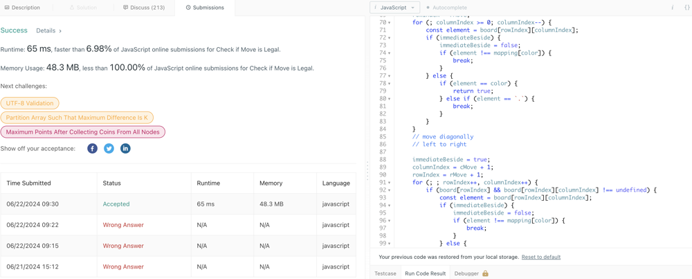

# ❇ check-if-move-is-legal Images👌 🏆O(N)❤️ Javascript🎯 Memory👀100%🕕 ++Explanation✍️🔴🔥✅💪🙏👉

**Author:** anurag-sindhu
**Votes:** 2
**Link:** [https://leetcode.com/problems/check-if-move-is-legal/solutions/5349779/](https://leetcode.com/problems/check-if-move-is-legal/solutions/5349779/)

---

Time Complexity: O(N)
Space Complexity: O(1)
```
var checkMove = function (board, rMove, cMove, color) {
    const mapping = {
        B: 'W',
        W: 'B',
    };
    board[rMove][cMove] = color;
    //move vertical

    let immediateBeside;
    let columnIndex;
    let rowIndex;

    for (
        immediateBeside = true, columnIndex = cMove, rowIndex = rMove + 1;
        rowIndex < board.length;
        rowIndex++
    ) {
        const element = board[rowIndex][columnIndex];
        if (immediateBeside) {
            immediateBeside = false;
            if (element !== mapping[color]) {
                break;
            }
        } else {
            if (element == color) {
                return true;
            } else if (element == `.`) {
                break;
            }
        }
    }

    for (
        immediateBeside = true, columnIndex = cMove, rowIndex = rMove - 1;
        rowIndex >= 0;
        rowIndex--
    ) {
        const element = board[rowIndex][columnIndex];
        if (immediateBeside) {
            immediateBeside = false;
            if (element !== mapping[color]) {
                break;
            }
        } else {
            if (element == color) {
                return true;
            } else if (element == `.`) {
                break;
            }
        }
    }
    //move horizontal
    for (
        immediateBeside = true, columnIndex = cMove + 1, rowIndex = rMove;
        columnIndex < board[rowIndex].length;
        columnIndex++
    ) {
        const element = board[rowIndex][columnIndex];
        if (immediateBeside) {
            immediateBeside = false;
            if (element !== mapping[color]) {
                break;
            }
        } else {
            if (element == color) {
                return true;
            } else if (element == `.`) {
                break;
            }
        }
    }

    for (
        immediateBeside = true, columnIndex = cMove - 1, rowIndex = rMove;
        columnIndex >= 0;
        columnIndex--
    ) {
        const element = board[rowIndex][columnIndex];
        if (immediateBeside) {
            immediateBeside = false;
            if (element !== mapping[color]) {
                break;
            }
        } else {
            if (element == color) {
                return true;
            } else if (element == `.`) {
                break;
            }
        }
    }
    // move diagonally
    // left to right
    for (
        immediateBeside = true, columnIndex = cMove + 1, rowIndex = rMove + 1;
        ;
        rowIndex++, columnIndex++
    ) {
        if (board[rowIndex] && board[rowIndex][columnIndex] !== undefined) {
            const element = board[rowIndex][columnIndex];
            if (immediateBeside) {
                immediateBeside = false;
                if (element !== mapping[color]) {
                    break;
                }
            } else {
                if (element == color) {
                    return true;
                } else if (element == `.`) {
                    break;
                }
            }
        } else {
            break;
        }
    }

    for (
        immediateBeside = true, columnIndex = cMove - 1, rowIndex = rMove - 1;
        ;
        rowIndex--, columnIndex--
    ) {
        if (board[rowIndex] && board[rowIndex][columnIndex] !== undefined) {
            const element = board[rowIndex][columnIndex];
            if (immediateBeside) {
                immediateBeside = false;
                if (element !== mapping[color]) {
                    break;
                }
            } else {
                if (element == color) {
                    return true;
                } else if (element == `.`) {
                    break;
                }
            }
        } else {
            break;
        }
    }

    // right to left
    for (
        immediateBeside = true, columnIndex = cMove + 1, rowIndex = rMove - 1;
        ;
        rowIndex--, columnIndex++
    ) {
        if (board[rowIndex] && board[rowIndex][columnIndex] !== undefined) {
            const element = board[rowIndex][columnIndex];
            if (immediateBeside) {
                immediateBeside = false;
                if (element !== mapping[color]) {
                    break;
                }
            } else {
                if (element == color) {
                    return true;
                } else if (element == `.`) {
                    break;
                }
            }
        } else {
            break;
        }
    }

    for (
        immediateBeside = true, rowIndex = rMove + 1, columnIndex = cMove - 1;
        columnIndex >= 0;
        rowIndex++, columnIndex--
    ) {
        if (board[rowIndex] && board[rowIndex][columnIndex] !== undefined) {
            const element = board[rowIndex][columnIndex];
            if (immediateBeside) {
                immediateBeside = false;
                if (element !== mapping[color]) {
                    break;
                }
            } else {
                if (element == color) {
                    return true;
                } else if (element == `.`) {
                    break;
                }
            }
        } else {
            break;
        }
    }
    return false;
};
```

