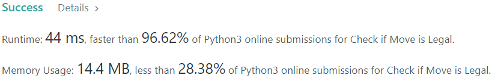

# Step in all legal directions, 96% speed

**Author:** EvgenySH
**Votes:** 1
**Link:** [https://leetcode.com/problems/check-if-move-is-legal/solutions/1450810/](https://leetcode.com/problems/check-if-move-is-legal/solutions/1450810/)

---


```
class Solution:
    def checkMove(self, board: List[List[str]], rMove: int, cMove: int, color: str) -> bool:
        directions = [False] * 8
        moves = [(1, 0), (1, 1), (0, 1), (-1, 1), (-1, 0),
                 (-1, -1), (0, -1), (1, -1)]
        opposite_color = "W" if color == "B" else "B"

        for d in range(8):
            r, c = rMove + moves[d][0], cMove + moves[d][1]
            if 0 <= r < 8 and 0 <= c < 8 and board[r][c] == opposite_color:
                directions[d] = True

        for step in range(2, 8):
            if not any(d for d in directions):
                return False
            for d in range(8):
                if directions[d]:
                    r, c = rMove + step * moves[d][0], cMove + step * moves[d][1]
                    if 0 <= r < 8 and 0 <= c < 8:
                        if board[r][c] == color:
                            return True
                        elif board[r][c] == ".":
                            directions[d] = False
                    else:
                        directions[d] = False
        return False
```