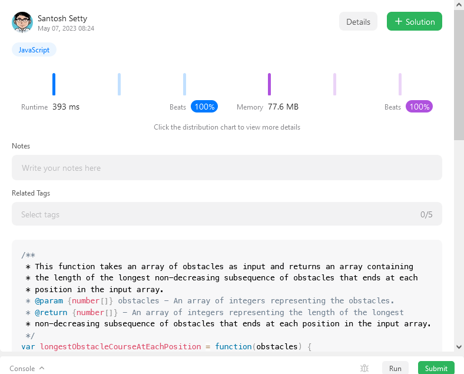

# Step-by-Step Guide to a Winning JavaScript Solution for Longest Obstacle Course Problem (100% Beats)

**Author:** santosh-setty
**Votes:** 8
**Link:** [https://leetcode.com/problems/find-the-longest-valid-obstacle-course-at-each-position/solutions/3494720/](https://leetcode.com/problems/find-the-longest-valid-obstacle-course-at-each-position/solutions/3494720/)

---




# Intuition
Use a stack to keep track of the increasing subsequence of obstacles encountered so far. 

For each obstacle, we check if it is greater than or equal to the last obstacle in the stack. If it is, we add it to the stack and the length of the non-decreasing subsequence ending at the current position is equal to the length of the stack. 

If it is not, we use binary search to find the position of the first obstacle in the stack that is greater than the current obstacle, replace the obstacle at that position with the current obstacle, and the length of the non-decreasing subsequence ending at the current position is equal to the position of the first obstacle in the stack that is greater than the current obstacle. 

We repeat this process for all obstacles in the input array to get the lengths of the longest non-decreasing subsequence of obstacles that ends at each position in the array.

# Approach
1. This is a function called longestObstacleCourseAtEachPosition that takes an array of obstacles as input.
2. The function returns an array containing the length of the longest non-decreasing subsequence of obstacles that ends at each position in the input array.
```js
    // Store the length of the input array
    const n = obstacles.length;
    // Create an array of length n and fill it with 1's
    const ans = new Array(n).fill(1);
    // Create a stack to store increasing subsequence of obstacles
    const stack = [obstacles[0]];
```
3. Store the length of the input array in a constant variable called n.
4. Create an array called ans of length n and fill it with 1's. This array will be used to store the length of the longest non-decreasing subsequence that ends at each position in the input array.
5. Create a stack called stack to store increasing subsequences of obstacles. Initialize the stack with the first obstacle in the input array.
```js
    // Iterate over each obstacle in the input array
    for (let i = 1; i < n; i++) {
        // If the current obstacle is greater than or equal to the last obstacle in the stack
        if (obstacles[i] >= stack[stack.length - 1]) {
            // Add the current obstacle to the stack
            stack.push(obstacles[i]);
            // The length of the non-decreasing subsequence ending at the current position is equal to the length of the stack
            ans[i] = stack.length;
        } else {
            // If the current obstacle is less than the last obstacle in the stack
            // Use binary search to find the position of the first obstacle in the stack that is greater than the current obstacle
            let l = 0;
            let r = stack.length - 1;

            while (l <= r) {
                const mid = Math.floor((l + r) / 2);
                if (stack[mid] <= obstacles[i]) {
                    l = mid + 1;
                } else {
                    r = mid - 1;
                }
            }

            // Replace the obstacle at the found position with the current obstacle
            stack[l] = obstacles[i];
            // The length of the non-decreasing subsequence ending at the current position is equal to the position of the first obstacle in the stack that is greater than the current obstacle
            ans[i] = l + 1;
        }
    }
```
6. Iterate over each obstacle in the input array starting from the second obstacle (i.e., i = 1).
7. If the current obstacle is greater than or equal to the last obstacle in the stack, add the current obstacle to the stack and set the length of the non-decreasing subsequence ending at the current position (i.e., ans[i]) to the length of the stack.
8. If the current obstacle is less than the last obstacle in the stack, use binary search to find the position of the first obstacle in the stack that

# Complexity
- Time complexity: O(n * log n)

- Space complexity:  O(n)

# Code
```
/**
 * This function takes an array of obstacles as input and returns an array containing
 * the length of the longest non-decreasing subsequence of obstacles that ends at each
 * position in the input array.
 * @param {number[]} obstacles - An array of integers representing the obstacles.
 * @return {number[]} - An array of integers representing the length of the longest
 * non-decreasing subsequence of obstacles that ends at each position in the input array.
 */
var longestObstacleCourseAtEachPosition = function(obstacles) {
    // Store the length of the input array
    const n = obstacles.length;
    // Create an array of length n and fill it with 1's
    const ans = new Array(n).fill(1);
    // Create a stack to store increasing subsequence of obstacles
    const stack = [obstacles[0]];

    // Iterate over each obstacle in the input array
    for (let i = 1; i < n; i++) {
        // If the current obstacle is greater than or equal to the last obstacle in the stack
        if (obstacles[i] >= stack[stack.length - 1]) {
            // Add the current obstacle to the stack
            stack.push(obstacles[i]);
            // The length of the non-decreasing subsequence ending at the current position is equal to the length of the stack
            ans[i] = stack.length;
        } else {
            // If the current obstacle is less than the last obstacle in the stack
            // Use binary search to find the position of the first obstacle in the stack that is greater than the current obstacle
            let l = 0;
            let r = stack.length - 1;

            while (l <= r) {
                const mid = Math.floor((l + r) / 2);
                if (stack[mid] <= obstacles[i]) {
                    l = mid + 1;
                } else {
                    r = mid - 1;
                }
            }

            // Replace the obstacle at the found position with the current obstacle
            stack[l] = obstacles[i];
            // The length of the non-decreasing subsequence ending at the current position is equal to the position of the first obstacle in the stack that is greater than the current obstacle
            ans[i] = l + 1;
        }
    }

    // Return the array of lengths of non-decreasing subsequences ending at each position in the input array
    return ans;
};

```