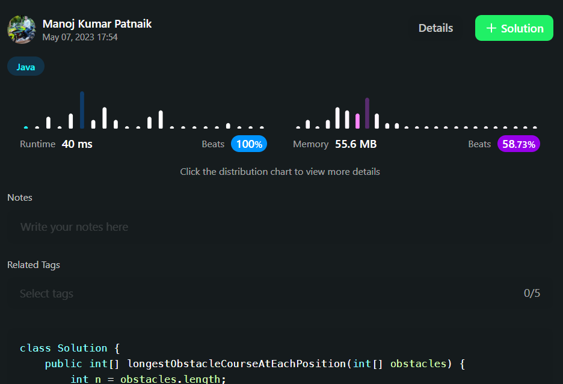

# ✔💯 DAY 402 | BRUTE->BETTER->OPTIMAL | Beats 100%  | [PYTHON/JAVA/C++] | EXPLAINED | Approach 🆙🆙🆙

**Author:** ManojKumarPatnaik
**Votes:** 17
**Link:** [https://leetcode.com/problems/find-the-longest-valid-obstacle-course-at-each-position/solutions/3496133/](https://leetcode.com/problems/find-the-longest-valid-obstacle-course-at-each-position/solutions/3496133/)

---


# Please Upvote as it really motivates me \uD83C\uDD99\uD83C\uDD99\uD83C\uDD99



# BRUTE  USING LIS
# intuition
we can use dynamic programming to find the length of the longest obstacle course for each index i in the input array  obstacles . We can iterate over all the obstacles from index 0 to index i and for each obstacle, we can update the length of the longest obstacle course seen so far for that obstacle. We can then update the answer array with the length of the longest obstacle course seen so far for the current obstacle, which is equal to the maximum length seen so far plus 1. By doing this, we can find the length of the longest obstacle course for each index i in the input array obstacles

```JAVA []
 public int[] longestObstacleCourseAtEachPosition(int[] obstacles) {
    int n = obstacles.length;
    int[] answer = new int[n];
    for (int i = 0; i < n; i++) {
        int maxLen = 0;
        for (int j = 0; j <= i; j++) {
            if (obstacles[j] <= obstacles[i]) {
                maxLen = Math.max(maxLen, answer[j]);
            }
        }
        answer[i] = maxLen + 1;
    }
    return answer;
}
```
NOTE: TLE FOR LARGER TC'S


# Complexity
- Time complexity:O(N^2)
<!-- Add your time complexity here, e.g. $$O(n)$$ -->

- Space complexity:O(n)
<!-- Add your space complexity here, e.g. $$O(n)$$ -->

# BETTER 

```JAVA []
public int[] longestObstacleCourseAtEachPosition(int[] nums) {
    List<Integer> lkp = new ArrayList();
    int[] result = new int[nums.length];
    result[0] = 1;
    lkp.add(nums[0]);
    for(int i=1; i<nums.length; i++){
        if(lkp.get(lkp.size()-1) <= nums[i]){
            lkp.add(nums[i]);
            result[i] = lkp.size();
        }else{
            int itr =0;
            while(itr < lkp.size() && lkp.get(itr) <= nums[i]) itr++;
            lkp.set(itr, nums[i]);
            result[i] = itr+1;
        }
    }
    return result; 
}
```


# Complexity
- Time complexity:o(n*k)
<!-- Add your time complexity here, e.g. $$O(n)$$ -->

- Space complexity:o(n)
<!-- Add your space complexity here, e.g. $$O(n)$$ -->

# optimal


# Intuition & Approach
<!-- Describe your approach to solving the problem. -->
##### \u2022	We have an array longestObstacleCourse of length  n to store the length of the longest obstacle course for each index  i

##### \u2022	We also initialize an array  lis of length  n to store the lowest increasing subsequence of length  i+1 seen so far.
##### \u2022	We initialize a variable  lisLength to 0 to keep track of the length of the longest increasing subsequence seen so far.
##### \u2022	We iterate over each obstacle in the input array  obstacles

##### \u2022	For each obstacle, we perform a binary search on the  lis array to find the rightmost insertion position for the current obstacle.
##### \u2022	We update the  Lis array with the current obstacle at the rightmost insertion position if the current obstacle is smaller than the obstacle at the rightmost insertion position.
##### \u2022	If the rightmost insertion position is equal to  lisLength, we increment  lisLength by 1.
##### \u2022	We update the  longestObstacleCourse array with the length of the increasing subsequence seen so far, which is equal to the rightmost insertion position plus 1.
##### \u2022	We return the longestObstacleCourse array as the final result.
##### \u2022	The intuition is that we can use a binary search to find the rightmost insertion position for each obstacle in the input array obstacles in the  lis array. We can then update the  lis array with the current obstacle at the rightmost insertion position if the current obstacle is smaller than the obstacle at the rightmost insertion position. We can also update the  longestObstacleCourse array with the length of the increasing subsequence seen so far, which is equal to the rightmost insertion position plus 1. By doing this, we can find the length of the longest obstacle course for each index  I in the input array  obstacles


# Code
```java []
class Solution {
    public int[] longestObstacleCourseAtEachPosition(int[] obstacles) {
    int length = obstacles.length;
    int longestObstacleCourse[] = new int[length]; // array to store the length of the longest obstacle course for each index i
    int lis[] = new int[length]; // array to store the lowest increasing subsequence of length i+1 seen so far
    int lisLength = 0; // variable to keep track of the length of the longest increasing subsequence seen so far
    for (int i = 0; i < length; i++) {
        int left = 0, right = lisLength;
        // perform binary search to find the rightmost insertion position for the current obstacle in the lis array
        while (left < right) {
            int middle = (left + right) >> 1;
            if (lis[middle] <= obstacles[i]) left = middle + 1;
            else right = middle;
        }
        // update the lis array with the current obstacle at the rightmost insertion position if the current obstacle is smaller than the obstacle at the rightmost insertion position
        if (left >= lisLength || lis[left] > obstacles[i]) lis[left] = obstacles[i];
        // if the rightmost insertion position is equal to lisLength, increment lisLength by 1
        if (left == lisLength) lisLength++;
        // update the longestObstacleCourse array with the length of the increasing subsequence seen so far, which is equal to the rightmost insertion position plus 1
        longestObstacleCourse[i] = left + 1;
    }
    return longestObstacleCourse; // return the longestObstacleCourse array as the final result
}
}
/*Time: O(nlogn)
Space: O(n)*/
```
```c++ []
vector<int> longestObCourseAtEachPosition(vector<int>& obstacles) {
    int n = obstacles.size();
    vector<int> longestObstacleCourse(n), lis(n);
    int lisLength = 0;
    for (int i = 0; i < n; i++) {
        int left = 0, right = lisLength;
        while (left < right) {
            int middle = (left + right) >> 1;
            if (lis[middle] <= obstacles[i]) left = middle + 1;
            else right = middle;
        }
        if (left >= lisLength || lis[left] > obstacles[i]) lis[left] = obstacles[i];
        if (left == lisLength) lisLength++;
        longestObstacleCourse[i] = left + 1;
    }
    return longestObstacleCourse;
}
```
```python []
def longestObstacleCourseAtEachPosition(obstacles: List[int]) -> List[int]:
    n = len(obstacles)
    longestObstacleCourse, lis = [0] * n, [0] * n
    lisLength = 0
    for i in range(n):
        left, right = 0, lisLength
        while left < right:
            middle = (left + right) >> 1
            if lis[middle] <= obstacles[i]:
                left = middle + 1
            else:
                right = middle
        if left >= lisLength or lis[left] > obstacles[i]:
            lis[left] = obstacles[i]
        if left == lisLength:
            lisLength += 1
        longestObstacleCourse[i] = left + 1
    return longestObstacleCourse
```

# Complexity
- Time complexity:o(n log n)
<!-- Add your time complexity here, e.g. $$O(n)$$ -->

- Space complexity:o(n)
<!-- Add your space complexity here, e.g. $$O(n)$$ -->


# Please Upvote\uD83D\uDC4D\uD83D\uDC4D
Thanks for visiting my solution.\uD83D\uDE0A Keep Learning
Please give my solution an upvote! \uD83D\uDC4D \uD83C\uDD99\uD83C\uDD99\uD83C\uDD99
It's a simple way to show your appreciation and
keep me motivated. Thank you! \uD83D\uDE0A