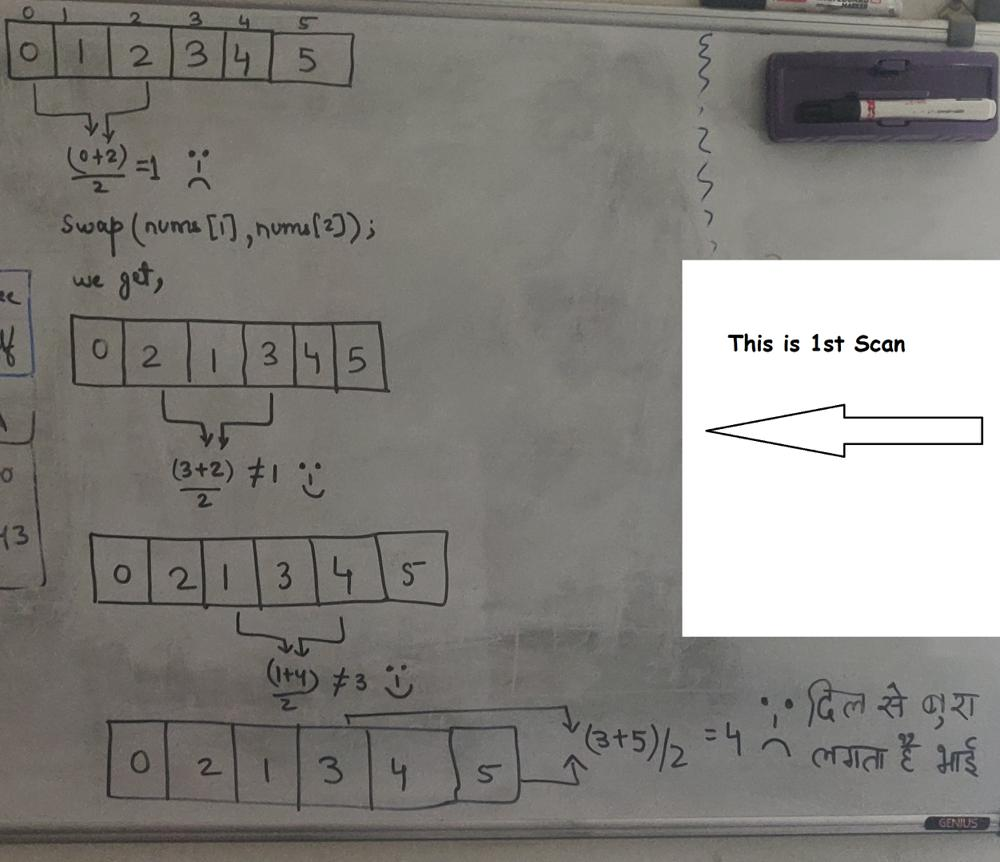
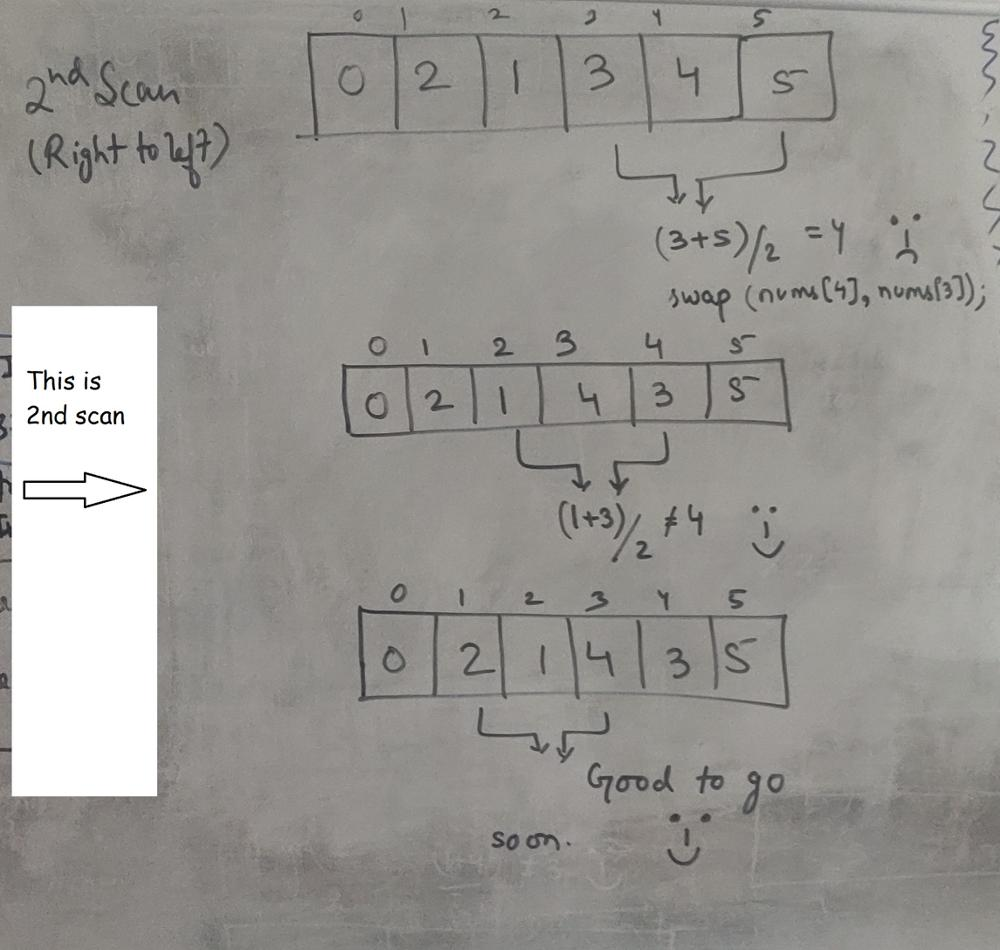

# C++ 2 approaches (simple intuition with example & diagram)

**Author:** Mazhar_MIK
**Votes:** 143
**Link:** [https://leetcode.com/problems/array-with-elements-not-equal-to-average-of-neighbors/solutions/1403946/](https://leetcode.com/problems/array-with-elements-not-equal-to-average-of-neighbors/solutions/1403946/)

---

Similar Problem : Wiggle Sort I and II

```
//Approach-1 (Using sorting O(nlogn))
/*
    If you make sure that
    nums[i-1] < nums[i] > nums[i+1]
    You are good to go.
    
    So, just sort the input and choose wisely to satisfy above condition.
    
    Example : 
    [6,2,0,9,7]
    sort it : [0, 2, 6, 7, 9]
    
    result  : [0, _, 2, _, 6] - 1st loop (fill alternaltely)
    result  : [0, 7, 2, 9, 6] - 2nd loop (fill next larger numbers from nums to result in spaces left)

*/

class Solution {
public:
    vector<int> rearrangeArray(vector<int>& nums) {
        int n = nums.size();
        sort(begin(nums), end(nums));
        
        vector<int> result(n);
        int j = 0;
        int i = 0;
        for(; i < n && j < n; i++, j += 2) //alternately fill so that you leave one space in between for large number
            result[j] = nums[i];
        
        
        j = 1;
        for(; i < n && j < n; i++, j += 2) //filter the large number in spaces between that we left above
            result[j] = nums[i];
        
        return result;
    }
};

```

```
//Approach-2 (O(n) without sorting)
/*
	There is a very simple approach to it as well.
	- Scan from left to right and fix the invalid triplets by swapping
	- Scan from right to left and fix the invalid triplets by swapping

	Note : If you only do the first scanning and expect it to be a valid result, it's not. It is not gauranteed.
			  Unfortunately the test cases are weak and only 1 test case fails if you do first scanning only 
			  (i.e you will get 219 / 220 test cases passed.)
			  Example : {0, 1, 2, 3, 4, 5} -> Only doing 1st scan will fail here (See the image at the bottom to see dry run)
*/

class Solution {
public:
    vector<int> rearrangeArray(vector<int>& nums) {
        int n = nums.size();
        
        // Move left to right and fix
        for (int i = 1; i < n - 1; i++) {

            if (2*nums[i] == (nums[i-1] + nums[i+1]))
                swap(nums[i], nums[i+1]);
        }
        
        // Move right to left and fix
        for (int i = nums.size() - 2; i > 0; i--) {

            if (2*nums[i] == (nums[i-1] + nums[i+1]))
                swap(nums[i], nums[i-1]);
        }
        return nums;
        
    }
};
```

1) First Scan


2) Second Scan

