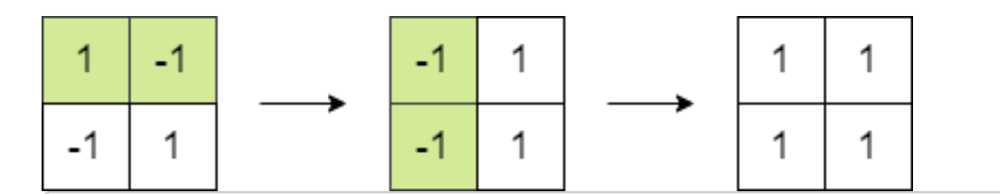
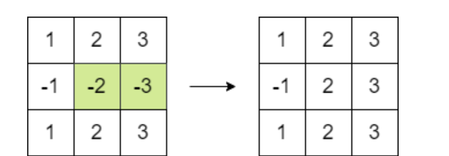

# [C++] Explained with Diagram

**Author:** warlock1997
**Votes:** 37
**Link:** [https://leetcode.com/problems/maximum-matrix-sum/solutions/1417574/](https://leetcode.com/problems/maximum-matrix-sum/solutions/1417574/)

---

### Logic 

It is clearly mentioned that we can pick any two adjacent cells and mutliply them by -1. Also, this operation can be repeated any number of times.

`You may notice that we can change the sign of any two elements just by selecting them and multiplying them by -1. `This means that the position of negative and positive numbers doesn't matter because we can definitely reach every cell and perform the same operation. 

`Another observation is that for any number, if we do this operation even number of times, then the sign of the element doesn't change. `



<br>

Bingo !! We will make use of this logic and one by one, make the negative numbers positive as much as we can. 

`NOTICE : If there are odd number of positive numbers in the matrix, then no matter what move you chose, you will always end up having one negative number at the end in the complete matrix because at any moment, we will be having odd number of negatives.  `



<br>


`We can make the smallest number is the matrix negative by performing this operation some x number of times and then we can get the result. `


### Approach 

1. Find the absolute sum of all the numbers in the matrix
2. Find the absolute value of the smallest number in the matrix
3. Count of negative numbers in the matrix

- `If count of negatives is even`, then all elements can be made positive by performing the operation, so just return the total sum of the matrix
- `If count of negatives is odd`, then we can make the smallest number in the matrix as negative and then return the `sum` 
	- NOTE : Here the result will be `sum-2*minElement` as you are not including this element. 

<br>

##### Please upvote if you like the explanation and the approach

<br>


### Accepted Solution

```
/**
 * @author      : archit
 * @GitHub      : archit-1997
 * @Email       : architsingh456@gmail.com
 * @file        : maximumMatrixSum.cpp
 * @created     : Saturday Aug 21, 2021 20:11:56 IST
 */

#include <bits/stdc++.h>
using namespace std;

class Solution {
public:
    long long maxMatrixSum(vector<vector<int>>& matrix) {
        int r=matrix.size(),c=matrix[0].size();

        //we need to find the min number in the matrix and also count of negative numbers in the matrix
        int small=INT_MAX,count=0;
        long long int sum=0;

        for(int i=0;i<r;i++){
            for(int j=0;j<c;j++){
                int val=matrix[i][j];
				//finding the smallest absolute value in the matrix
                small=min(small,abs(val));
				//counting the negative numbers
                if(val<0)
                    count++;
				//finding the sum of all the values
                sum+=abs(val);
            }
        }
		//if even number of negatives, then just return sum
        if(count%2==0)
            return sum;
        else
		//subtract the value of the min absolute element
            return sum-2*small;
    }
};

```