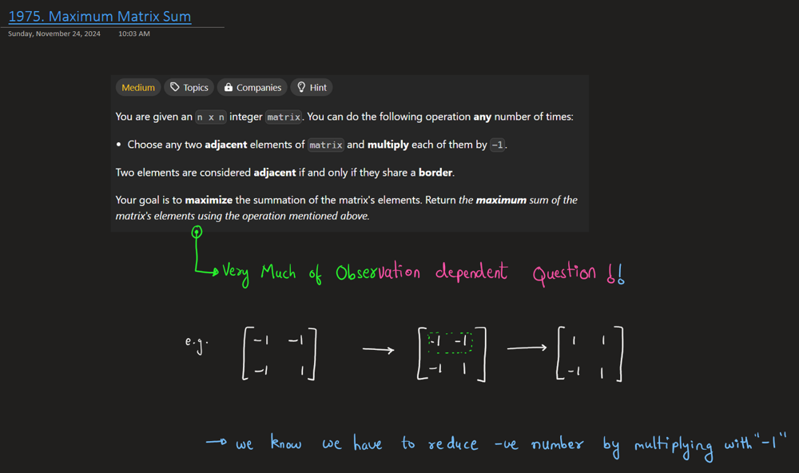
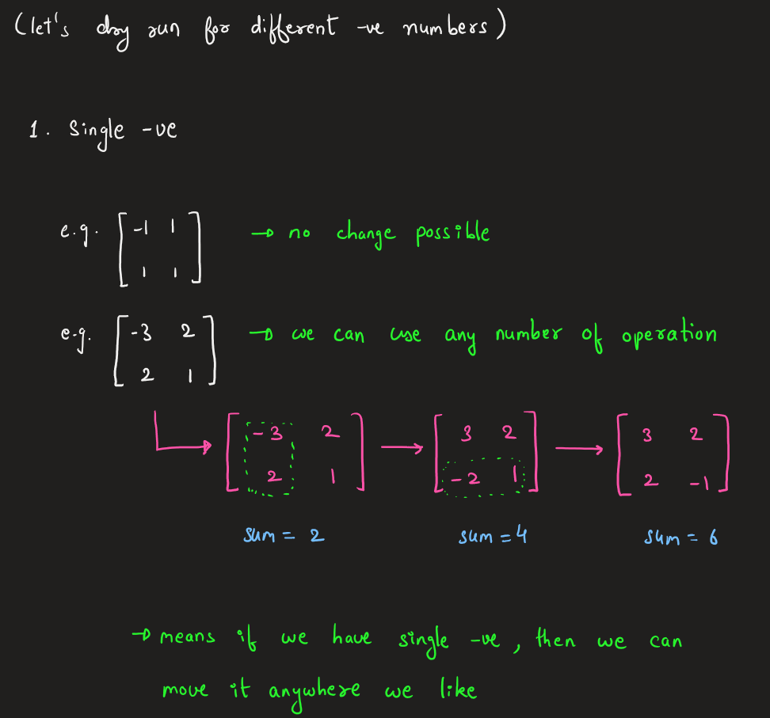
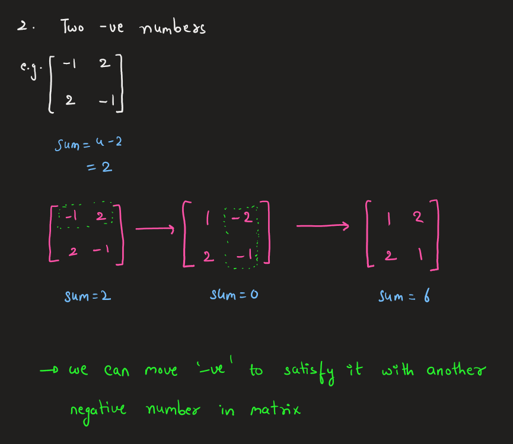
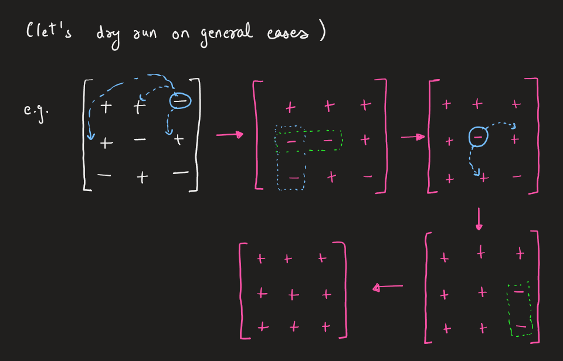
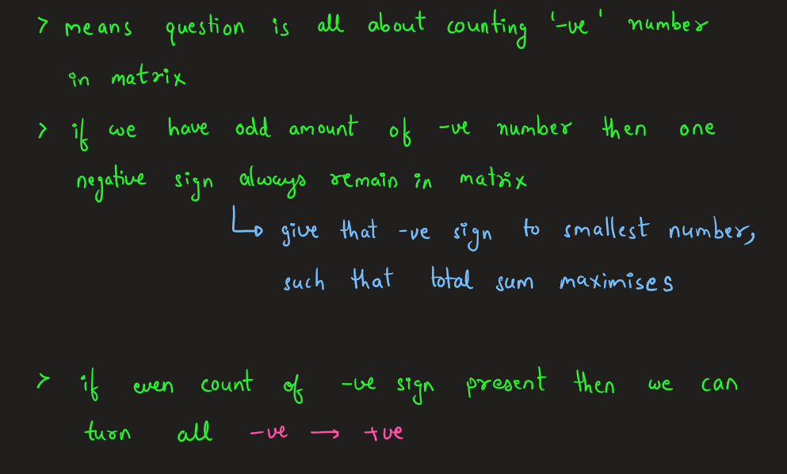

# Intution -> Observation -> Code Conversion idea || Very Easy Diagram explain

**Author:** Rarma
**Votes:** 20
**Link:** [https://leetcode.com/problems/maximum-matrix-sum/solutions/6077594/](https://leetcode.com/problems/maximum-matrix-sum/solutions/6077594/)

---

# Youtube Explanation
Soon to be on Channel : https://www.youtube.com/@Intuit_and_Code
Edited:
https://youtu.be/zTSzxOvw_yg?si=x3agO7LMkmcMNtGM

# Intuition and Approach
> This Question is completely observation based, when you dry run some example you will be like suddenly *" Oh, that's what it is happening !"*








# Complexity
- Time complexity: O(row x col)
- Space complexity: O(1)

# Code
``` Codes>>> [ ]
Hope You Enjoyed the Explanation !!
```
```cpp []
#define ll long long
class Solution {
public:
    ll maxMatrixSum(vector<vector<int>>& matrix) {
        ll sum = 0, n = matrix.size(), cnt = 0, mini=INT_MAX;
        for(int row=0;row<n;row++){
            for(int col=0;col<n;col++){
                if(matrix[row][col] < 0){
                    cnt++;
                }
                mini = min((ll)abs(matrix[row][col]), mini);
                sum += abs(matrix[row][col]);
            }
        }
        
        if(cnt&1){
            sum -= (2*mini);
        }
        return sum;
    }
};
```
``` Java [ ]
class Solution {
    public long maxMatrixSum(int[][] matrix) {
        long sum = 0, mini = Long.MAX_VALUE;
        int n = matrix.length, cnt = 0;
        
        for (int row = 0; row < n; row++) {
            for (int col = 0; col < n; col++) {
                if (matrix[row][col] < 0) {
                    cnt++;
                }
                mini = Math.min(Math.abs(matrix[row][col]), mini);
                sum += Math.abs(matrix[row][col]);
            }
        }
        
        if ((cnt & 1) == 1) {
            sum -= (2 * mini);
        }
        return sum;
    }
}
```
``` Py [ ]
class Solution:
    def maxMatrixSum(self, matrix: List[List[int]]) -> int:
        total_sum = 0
        mini = float('inf')
        cnt = 0
        
        for row in matrix:
            for val in row:
                if val < 0:
                    cnt += 1
                mini = min(abs(val), mini)
                total_sum += abs(val)
        
        if cnt % 2 == 1:
            total_sum -= 2 * mini
        
        return total_sum
```
``` Go [ ]
func maxMatrixSum(matrix [][]int) int64 {
    var sum int64 = 0
    mini := int64(^uint64(0) >> 1) // Max int64 value
    cnt := 0
    
    for _, row := range matrix {
        for _, val := range row {
            if val < 0 {
                cnt++
            }
            absVal := int64(val)
            if absVal < 0 {
                absVal = -absVal
            }
            if absVal < mini {
                mini = absVal
            }
            sum += absVal
        }
    }
    
    if cnt%2 == 1 {
        sum -= 2 * mini
    }
    return sum
}
```
``` JavaScript [ ]
var maxMatrixSum = function(matrix) {
    let sum = 0, mini = Number.MAX_SAFE_INTEGER, cnt = 0;
    const n = matrix.length;
    
    for (let row = 0; row < n; row++) {
        for (let col = 0; col < n; col++) {
            const val = matrix[row][col];
            if (val < 0) {
                cnt++;
            }
            mini = Math.min(Math.abs(val), mini);
            sum += Math.abs(val);
        }
    }
    
    if (cnt % 2 === 1) {
        sum -= 2 * mini;
    }
    return sum;
};
```
``` Ruby [ ]
def max_matrix_sum(matrix)
    sum = 0
    mini = Float::INFINITY
    cnt = 0
    
    matrix.each do |row|
        row.each do |val|
            cnt += 1 if val < 0
            mini = [mini, val.abs].min
            sum += val.abs
        end
    end
    
    sum -= 2 * mini if cnt.odd?
    sum
end
```