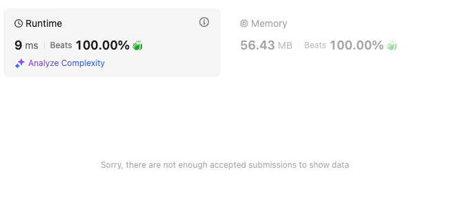

# Count negative, O(N), 9ms, 56.43MB

**Author:** yunhao_liu
**Votes:** 3
**Link:** [https://leetcode.com/problems/maximum-matrix-sum/solutions/6078505/](https://leetcode.com/problems/maximum-matrix-sum/solutions/6078505/)

---




# Intuition 
For 1 row, if there are even negative numbers, we can flip them all to positive, no matter those negative are adjacent or not. If there are odd negative numbers, we should sacrifice the minimum absolute value, to let it become negative. For example: 
```
-5 1 2 -3 -4
```
after several pairly flips, we could leave `1` as negative and make:
```
5 -1 2 3 4
```

Now considering several rows together, it will be the same logic. If it has even negatives in total, we can always flip negatives to neighbours and flip them all to positive. If odd, we should leave the minimum absolute value. 

That comes up with the solution: we add-up all absolute values on-the-go, keep track of the minimum and count negative. At the end, based on the count, we decide it should remove the minimum (twice) or stay the same. 

# Approach
Initialize the result, negative count and minimum absolute value:
```
        var result = 0L
        var negCount = 0
        var minAbsNum = Int.MAX_VALUE
```
Iterate the matrix, count negative numbers. Add-up absolute value, update minimum absolute value if needed.
```
        for (row in matrix) {
            for (num in row) {
                if (num < 0) {
                    negCount++
                }
                val absNum = Math.abs(num)
                result += absNum
                minAbsNum = minOf(minAbsNum, absNum)
            }
        }
```
After the iteration, if there are odd negative numbers, we should remove the minimum absolute value **twice**. Removing once is to remove the added-up value during the iteration, and another time is to add its negative value to result.
```
        if (negCount % 2 == 1) {
            result -= minAbsNum * 2
        }
        return result
```

# Complexity
- Time complexity:
$$O(n)$$ iteration once

- Space complexity:
$$O(1)$$

# Code
```kotlin []
class Solution {
    fun maxMatrixSum(matrix: Array<IntArray>): Long {
        var result = 0L
        var negCount = 0
        var minAbsNum = Int.MAX_VALUE
        for (row in matrix) {
            for (num in row) {
                if (num < 0) {
                    negCount++
                }
                val absNum = Math.abs(num)
                result += absNum
                minAbsNum = minOf(minAbsNum, absNum)
            }
        }
        if (negCount % 2 == 1) {
            result -= minAbsNum * 2
        }
        return result
    }
}
```