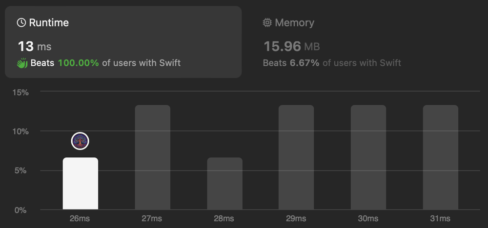

# ✅ Fastest Solution

**Author:** eleev
**Votes:** 2
**Link:** [https://leetcode.com/problems/find-greatest-common-divisor-of-array/solutions/4727966/](https://leetcode.com/problems/find-greatest-common-divisor-of-array/solutions/4727966/)

---



# Approach
**TODO**

# Time Complexity
**TODO**

# Space complexity
**TODO**

# Code
```swift
final class Solution<T: FixedWidthInteger> {
    @_optimize(speed)
    func findGCD(_ nums: [T]) -> T {
        nums.minMax()
            .reduce(0, gcd(_:_:))
    }
}

fileprivate extension Solution {
    func gcd(_ a: T, _ b: T) -> T {
        let remainder = a % b
        return remainder == 0 ? b : gcd(b, remainder)
    }
}

fileprivate extension Collection where Element: FixedWidthInteger {
    func minMax() -> [Element] {
        var (min, max) = (Element.max, Element.min)
        
        for num in self {
            min = Swift.min(min, num)
            max = Swift.max(max, num)
        }
        return [min, max]
    }
}
```