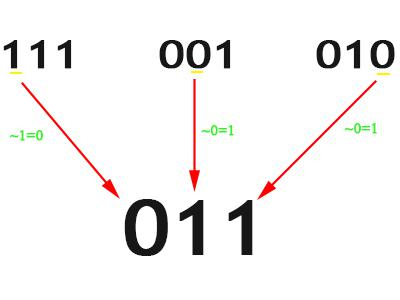

# ✅ Detailed Explanation O(N) [Java, C++, Python] short, concise code [Cantor's Diagonalization]

**Author:** ashucrma
**Votes:** 700
**Link:** [https://leetcode.com/problems/find-unique-binary-string/solutions/1418687/](https://leetcode.com/problems/find-unique-binary-string/solutions/1418687/)

---

The trick to do this question is somewhat similar to **Cantor's Diagonalization**. You can read about it in detail [here](https://en.wikipedia.org/wiki/Cantor%27s_diagonal_argument).

Since we are given that number of bits in the number is equal to number of elements.
What we can do is we create a binary string which differs from first binary at 1st position, second binary at 2nd position, third binary at 3rd position,...and so on.

This will make sure that the binary we have made is unique (as it differs from all others at atleast one position).

We create an empty string first.
And simply iterate through the binary strings while putting the flipped bit of ith bit of "binary at ith position". 
```
	for(int i=0; i<nums.size(); i++) 
		ans+= nums[i][i]=='0' ? '1' : '0';
```

I have created this image explaining the process for test case ["111", "001", "010"] :

**C++:** 
```
class Solution {
public:
    string findDifferentBinaryString(vector<string>& nums) {
        string ans="";
        for(int i=0; i<nums.size(); i++) 
            ans+= nums[i][i]=='0' ? '1' : '0';          // Using ternary operator
			// ans+=to_string(1-(nums[i][i]-'0'));     // Alternate:  or use to_string & 1-x to flip
        return ans;
    }
};
```


**Java:**   (0ms , faster than 100% in time)
```
class Solution {
    public String findDifferentBinaryString(String[] nums) {
        StringBuilder ans= new StringBuilder();                  
        for(int i=0; i<nums.length; i++)  
            ans.append(nums[i].charAt(i) == '0' ? '1' : '0');              // Using ternary operator
        return ans.toString();
    }
}
```

**Python:**      (faster than 100% in time & space both)
```
class Solution(object):
    def findDifferentBinaryString(self, nums):
        ans='';
        for i,num in enumerate(nums):
            ans+= '1' if(num[i]=='0') else '0'       #ternary if else
			#ans+= str(1- int(num[i]));              # Alternate: cast to string & 1-x to flip
        return ans;
 ```       

**Python 1 liner :** (faster than 100% in time & space both)
```
return ''.join(['1' if num[i]=='0' else '0' for i,num in enumerate(nums)])
```

**Time Complexity Analysis:**
Time: O(N)  :     We iterated throught the array just once.
Space: O(1) :      No extra space used. 


**Please upvote if you liked it.**

