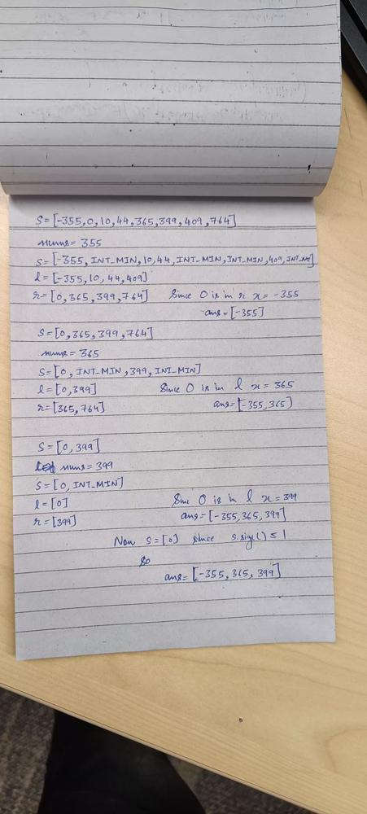

# C++ solution

**Author:** kushalatolia
**Votes:** 3
**Link:** [https://leetcode.com/problems/find-array-given-subset-sums/solutions/4350822/](https://leetcode.com/problems/find-array-given-subset-sums/solutions/4350822/)

---

# Intuition

<!-- Describe your first thoughts on how to solve this problem. -->

# Approach
<!-- Describe your approach to solving the problem. -->

# Complexity
- Time complexity:
<!-- Add your time complexity here, e.g. $$O(n)$$ -->

- Space complexity:
<!-- Add your space complexity here, e.g. $$O(n)$$ -->

# Code
```
class Solution {
public:
    vector<int> recoverArray(int n, vector<int>& s) {
    vector<int> res;
    sort(begin(s), end(s));
    while (s.size() > 1) {
        vector<int> l, r;
        int num = s[1] - s[0];
        bool l_zero = false;
        for (int i = 0, j = 0; i < s.size(); ++i)
            if (s[i] != INT_MIN) {
                if(s[i]==0)
                    l_zero=true;
                l.push_back(s[i]);
                r.push_back(s[i] + num);
                for (j = max(j + 1, i + 1); s[j] != s[i] + num; ++j);
                s[j] = INT_MIN;                    
            }
        if(l_zero)
        {
            res.push_back(num);
            swap(s,l);
        }
        else 
        {
            res.push_back(num*(-1));
            swap(s,r);
        }
    }
    return res;
}
};
```