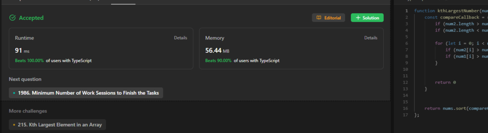

# Runtime beats 100% Memory beats 100%

**Author:** natanalegarh
**Votes:** 0
**Link:** [https://leetcode.com/problems/find-the-kth-largest-integer-in-the-array/solutions/3975092/](https://leetcode.com/problems/find-the-kth-largest-integer-in-the-array/solutions/3975092/)

---




# Intuition
<!-- Describe your first thoughts on how to solve this problem. -->

# Approach
<!-- Describe your approach to solving the problem. -->

# Complexity
- Time complexity:
<!-- Add your time complexity here, e.g. $$O(n)$$ -->

- Space complexity:
<!-- Add your space complexity here, e.g. $$O(n)$$ -->

# Code
```
function kthLargestNumber(nums: string[], k: number): string {
    return nums.sort(compareCallback)[k - 1].toString();
};


const compareCallback = (num1: string, num2: string): number => {
    if (num2.length > num1.length) return 1
    if (num2.length < num1.length) return -1

    for (let i = 0; i < num2.length; i++) {
        if (num2[i] > num1[i]) return 1
        if (num1[i] > num2[i]) return -1
    }


    return 0
}
```