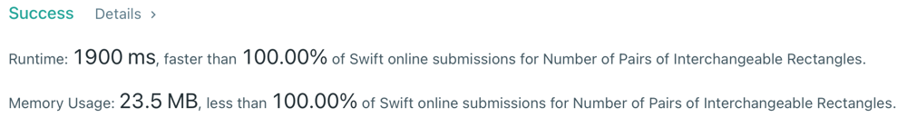

# Simple |  Faster than 100%

**Author:** efk
**Votes:** 1
**Link:** [https://leetcode.com/problems/number-of-pairs-of-interchangeable-rectangles/solutions/1523920/](https://leetcode.com/problems/number-of-pairs-of-interchangeable-rectangles/solutions/1523920/)

---

```swift
class Solution {
    func interchangeableRectangles(_ rectangles: [[Int]]) -> Int {
        var pairs = 0
        
        guard 0 < rectangles.count else {
            return pairs
        }

        let sortedRatios = rectangles.map{Double($0[0]) / Double($0[1])}.sorted()
        
        var prevRatio: Double? = nil
        var counter = 0
        
        for curRatio in sortedRatios {
            if prevRatio == nil || Double.ulpOfOne < fabs(curRatio - prevRatio!) {
                pairs += counter * (counter - 1) / 2

                prevRatio = curRatio
                counter = 1
            } else {
                counter += 1
            }
        }

        pairs += counter * (counter - 1) / 2

        return pairs
    }
}
```

