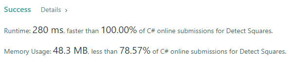

# C# simple and fast solution

**Author:** pawel753
**Votes:** 1
**Link:** [https://leetcode.com/problems/detect-squares/solutions/1632887/](https://leetcode.com/problems/detect-squares/solutions/1632887/)

---

We store each point in rows and columns - rows stands for values on the Y-axis, columns for values added on X-axis.
When querying the Count for a given point P = (x, y) we interate over all elements **from the same ROW** as P i.e. `row[P.y]` because `P.y` defines the row index. For each item in the same **ROW** we assume it's the secon point of a square (first is queried point P) so we look for two additional points of the square by querying the **COLUMS** with a given square side length.

We could use generic ***List<>*** to simplify the code but runtime jumps to 2800ms, when using ***Dictionary*** the runtime is only 280ms

```
public class DetectSquares
{
	Dictionary<int, int>[] rows;
	Dictionary<int, int>[] cols;

	public DetectSquares()
	{
		rows = new Dictionary<int, int>[1001];
		cols = new Dictionary<int, int>[1001];
	}

	public void Add(int[] point)
	{
		int x = point[0];
		int y = point[1];
		if (rows[y] == null)
			rows[y] = new Dictionary<int, int>();
		if (cols[x] == null)
			cols[x] = new Dictionary<int, int>();
		if (!rows[y].ContainsKey(x))
			rows[y].Add(x, 0);
		if (!cols[x].ContainsKey(y))
			cols[x].Add(y, 0);

		rows[y][x]++;
		cols[x][y]++;
	}

	public int Count(int[] point)
	{
		int x = point[0];
		int y = point[1];
		int res = 0;

		if (rows[y] != null)
			foreach (var kvp in rows[y])    //all added points on the same Y-axis level
			{
				var xprim = kvp.Key;
				var quantity = kvp.Value;

				if (xprim == x)
					continue;
				var d = Math.Abs(x - xprim);
				//count all squares alligned LEFT from the query point (x,y)
				if (y - d >= 0 && cols[xprim]?.ContainsKey(y - d) == true && cols[x]?.ContainsKey(y - d) == true)
					res += quantity * cols[xprim][y - d] * cols[x][y - d];
				//count all squares alligned RIGHT from the query point (x,y)
				if (y + d <= 1000 && cols[xprim]?.ContainsKey(y + d) == true && cols[x]?.ContainsKey(y + d) == true)
					res += quantity * cols[xprim][y + d] * cols[x][y + d];
			}

		return res;
	}
}
```