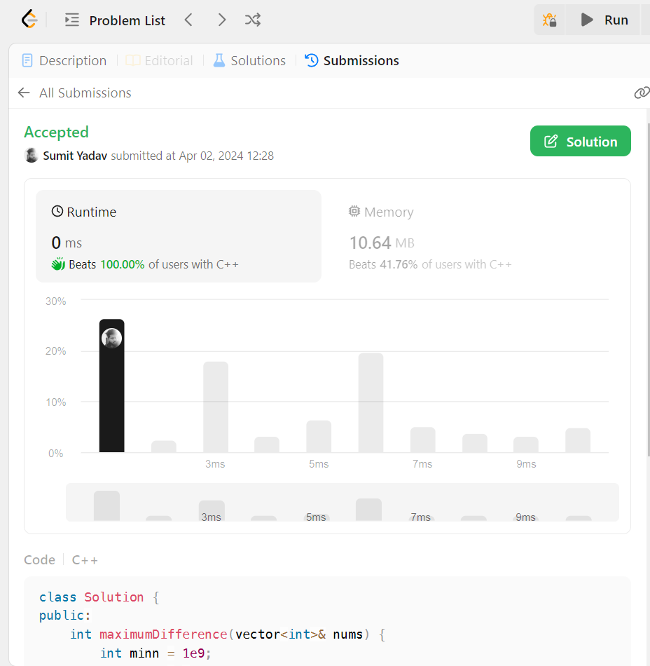

# ✅☑️ Beats 100% || Easiest Possible Solution || Beginner friendly

**Author:** sumit4199
**Votes:** 6
**Link:** [https://leetcode.com/problems/maximum-difference-between-increasing-elements/solutions/4961411/](https://leetcode.com/problems/maximum-difference-between-increasing-elements/solutions/4961411/)

---

image.png

# Intuition
**Iterating through the list:**

For each element i in the input list nums, the code checks whether i is less than or equal to the current minimum value minn.

If i is less than or equal to minn, it updates minn to i, effectively updating the minimum value seen so far.

If i is greater than minn, it calculates the difference between i and minn and checks if it is greater than the current maximum difference diff. If it is, diff is updated to this new maximum difference.


# Complexity
- Time complexity: O(N)
<!-- Add your time complexity here, e.g. $$O(n)$$ -->

- Space complexity:O(1)
<!-- Add your space complexity here, e.g. $$O(n)$$ -->

# PYTHON 3
```
class Solution:
    def maximumDifference(self, nums: List[int]) -> int:
        minn = 1e9
        diff = -1
        for i in nums:
            if i <= minn:
                minn = i
            else:
                diff = max(diff,i-minn)
        return diff
```

# JAVA
```
class Solution {
    public int maximumDifference(int[] nums) {
        int minn = Integer.MAX_VALUE;
        int diff = -1;
        for (int i : nums) {
            if (i <= minn) {
                minn = i;
            } else {
                diff = Math.max(diff, i - minn);
            }
        }
        return diff;
    }
}
```

# CPP
```
class Solution {
public:
    int maximumDifference(vector<int>& nums) {
        int minn = 1e9;
        int diff = -1;
        for (int i : nums) {
            if (i <= minn) {
                minn = i;
            } else {
                diff = max(diff, i - minn);
            }
        }
        return diff;
    }
};
