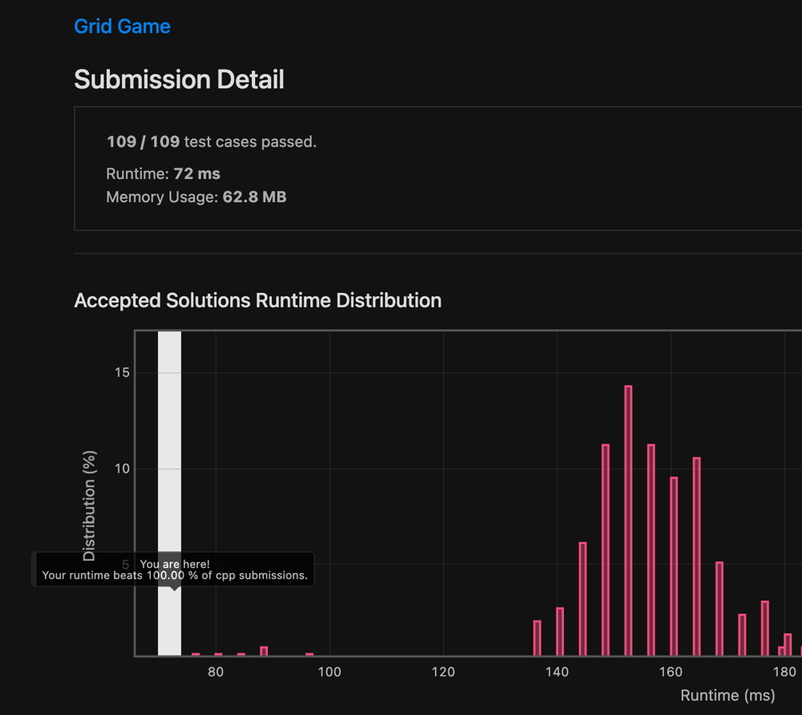

# [C++] Single Pass, Constant Space Solution, 100% Time (72ms), 100% Space

**Author:** Ajna2
**Votes:** 4
**Link:** [https://leetcode.com/problems/grid-game/solutions/1652636/](https://leetcode.com/problems/grid-game/solutions/1652636/)

---

This was really an outstanding problem, since it led me to think in more than a way.

Like probably many others, I started writing code that was maximising what robot1 would have harvested, assuming that would have led to robot2 taking only the smallest leftovers that way, but I was wrong (and unnecessarily convoluted).

Turns out that the core part of this problem is, as I initially figured out correctly, to find where we go down, from the first to the second row.

From there, we can assume that robot2 can either take all the cells left on the upper right part of the grid from where we went down with the robot1 or the lower left part of it.

In other words, we will always end up with something like this:

```cpp
  0   1   2  ... i-2 i-1   i i+1 i+2  ... n-2 n-1   n
 r1  r1  r1  ...  r1  r1  r1  p1  p1  ...  p1  p1  p1
 p2  p2  p2  ...  p2  p2  r1  r1  r1  ...  r1  r1  r1
```
In other words, for index `i`, we will have to pick the best move for robot2 among the sum of all the `p1` values of the first possibile option in the top right sector versus the sum of all the values `p2` from the second optionin the bottom left sector.

We might be tempted to go for a dynamic programming solution, storing all the prefix and suffix sums we might find this way in the upper and lower rows, but if we notice that we are just using each one of them at a time to both find our result and generate the next, all that we really need is two variables.

With this in mind, we can easily proceed to turn the idea into code, starting with a few support variables (all `long`, to avoid overflow, but not `long long` as in the unnecessary signature of the function, since we will never get such large values, given the constraints):
* `up` will be the sum of all the elements in the upper row right of `i`, initially set to be the sum of all the elements in `grid[0]` but the first (I know, this technically makes my solution not really a single pass, but cut me some slack);
* `down` will be the sum of all the elements in the lower row left of `i`, initially set to be `0`;
* `res`, initially set to be `up`.

We will then parse all the elements in `grid` starting from the second with `i` (initialised with the matching index `1`, since we already did the very first case while initialising our values) and:
* decrease `up` by the value of the matching cell in the upper row, `grid[0][i]`;
* increase `down` by the value of the previous cell in the lower row, `grid[1][i - 1]`;
* find the best option for robot2 (`max(up, down)`) and then take the minimum between that and the current value of `res`, since robot1 plays an adverse game and wants to reduce that.

Once done, we can `return` `res` :)

The code:

```cpp
class Solution {
public:
    long long gridGame(vector<vector<int>>& grid) {
        // support variables
        long up = accumulate(begin(grid[0]) + 1, end(grid[0]), 0l), down = 0, res = up;
        // turning grid into its incremental sum equivalent from the right
        for (int i = 1, lmt = grid[0].size(); i < len; i++) {
            up -= grid[0][i], down += grid[1][i - 1];
            res = min(res, max(up, down));
        }
        return res;
    }
};
```

The brag:

