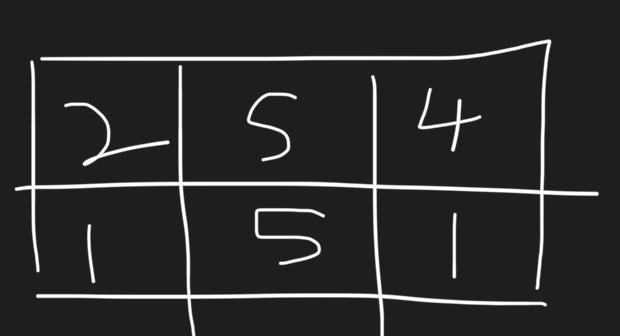
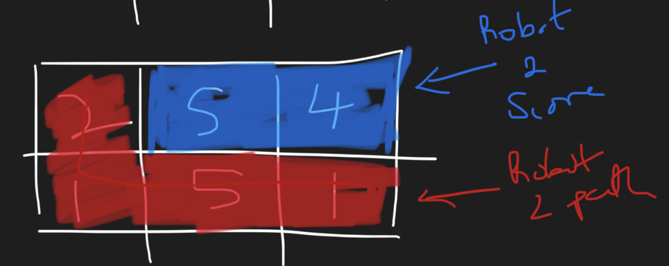
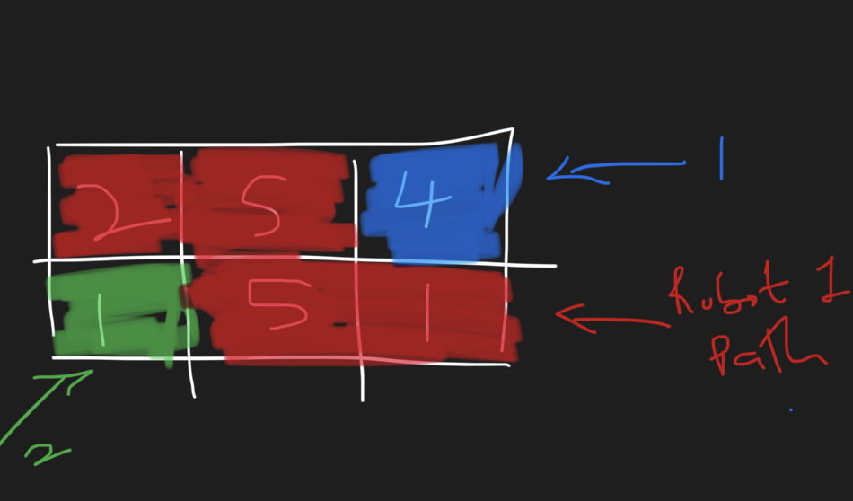
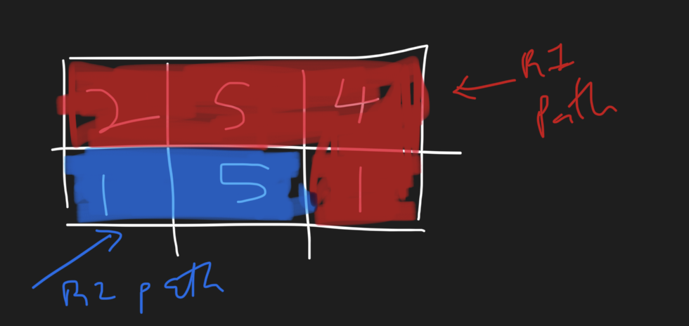

# Typescript || Prefix Sum || Matrix || O(n) - time || O(n) - space

**Author:** onifs10
**Votes:** 2
**Link:** [https://leetcode.com/problems/grid-game/solutions/3977845/](https://leetcode.com/problems/grid-game/solutions/3977845/)

---

# Intuition
Key Takeways from the problem statement:

- Robots can move down only once as they can move down and right and there are only 2 rows

- First Robot `robot1` doesn't have to get the maximum sum, it only has to minimise the second robot's sum

---

when a path is created by `robot1` the two groups of cells seperated by the `robot1` path are the two possible point group that can be gotten by `robot2`, the max between this two is the point for `robot2` when `robot1` create the path

---


Given the grid below



we get all the possible path for `robot1` and for each path we get the max point that `robot2` can get (which is the max between the groups seperated by the `robot1` path)

---


### Path 1

for this path (red)  it only leaves one group (blue),

red_path = `robot1` = 2 -> 1 -> 5 -> 1

group1 = 5 + 4 = 9
max path for `robot2` = max(9) = 9


---


### Path 2

for this path (red) it leaves 2 groups (blue amd green),

red_path = `robot1` = 2 -> 5 -> 5 -> 1

group1 = 4 
group2 = 1 
max path for `robot2` = max(1,4) = 4

---

### Path 3

for this path (red)  it only leaves one group (blue),

red_path = `robot1` = 2 -> 5 -> 4 -> 1 

group1 = 5 + 1 = 6  
max path for `robot2` = max(6) = 6

---

The problem says `robot1` moves to make path that would minimize the maximum score acquirable by `robot2`

so `ans = min(...max_scores_of_robot2)` = `min(6,4,9)` = 9


# Approach
Using prefix sum can get the sum for the top group and the bottom group created by the red path

# Complexity
- Time complexity:
$$O(n)$$

- Space complexity:
$$O(n)$$

# Code
```
function gridGame(grid: number[][]): number {

    let prefixSums = new Array(grid[0].length + 1).fill(0)
    
    for(let i = grid[0].length-1; i >= 0; i--){
        prefixSums[i] = grid[0][i] + prefixSums[i+1]
    }
    
    let bottom = 0
    let minResult = Infinity
    for(let i = 0; i < grid[0].length;i++){
        let side = prefixSums[i+1]
        let robotTwoMax = Math.max(side, bottom)
        minResult = Math.min(minResult,robotTwoMax)
        bottom += grid[1][i]
    }
    return minResult
};
```