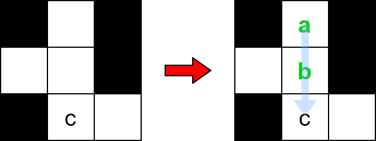
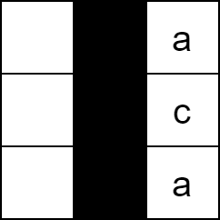
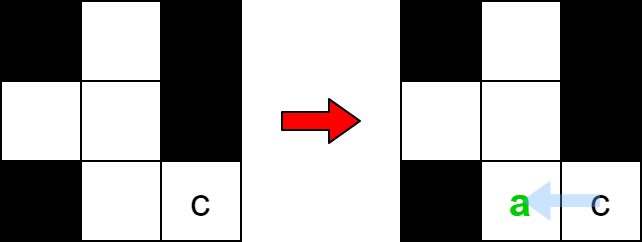

# [2018. Check if Word Can Be Placed In Crossword](https://leetcode.com/problems/check-if-word-can-be-placed-in-crossword/)

| Category | Difficulty | Likes | Dislikes |
| :------: | :--------: | :---: | :------: |
| Algorithms | Medium | 326 | 311 |

**Tags:** [`array`](https://leetcode.com/tag/array), [`matrix`](https://leetcode.com/tag/matrix), [`enumeration`](https://leetcode.com/tag/enumeration)

**Companies:** `google`

## Description

You are given an `m x n` matrix `board`, representing the** current **state of a crossword puzzle. The crossword contains lowercase English letters (from solved words), `' '` to represent any **empty **cells, and `'#'` to represent any **blocked** cells.

A word can be placed** horizontally** (left to right **or** right to left) or **vertically** (top to bottom **or** bottom to top) in the board if:

	- It does not occupy a cell containing the character `'#'`.

	- The cell each letter is placed in must either be `' '` (empty) or **match** the letter already on the `board`.

	- There must not be any empty cells `' '` or other lowercase letters **directly left or right**** **of the word if the word was placed **horizontally**.

	- There must not be any empty cells `' '` or other lowercase letters **directly above or below** the word if the word was placed **vertically**.

Given a string `word`, return `true`* if *`word`* can be placed in *`board`*, or *`false`* **otherwise***.

 

**Example 1:**


```

Input: board = [[&quot;#&quot;, &quot; &quot;, &quot;#&quot;], [&quot; &quot;, &quot; &quot;, &quot;#&quot;], [&quot;#&quot;, &quot;c&quot;, &quot; &quot;]], word = &quot;abc&quot;
Output: true
Explanation: The word &quot;abc&quot; can be placed as shown above (top to bottom).

```

**Example 2:**


```

Input: board = [[&quot; &quot;, &quot;#&quot;, &quot;a&quot;], [&quot; &quot;, &quot;#&quot;, &quot;c&quot;], [&quot; &quot;, &quot;#&quot;, &quot;a&quot;]], word = &quot;ac&quot;
Output: false
Explanation: It is impossible to place the word because there will always be a space/letter above or below it.
```

**Example 3:**


```

Input: board = [[&quot;#&quot;, &quot; &quot;, &quot;#&quot;], [&quot; &quot;, &quot; &quot;, &quot;#&quot;], [&quot;#&quot;, &quot; &quot;, &quot;c&quot;]], word = &quot;ca&quot;
Output: true
Explanation: The word &quot;ca&quot; can be placed as shown above (right to left). 

```

 

**Constraints:**

	- `m == board.length`

	- `n == board[i].length`

	- `1 <= m * n <= 2 * 10^5`

	- `board[i][j]` will be `' '`, `'#'`, or a lowercase English letter.

	- `1 <= word.length <= max(m, n)`

	- `word` will contain only lowercase English letters.

---

**Links:** [Submissions](https://leetcode.com/problems/check-if-word-can-be-placed-in-crossword/) | [Solutions](https://leetcode.com/problems/check-if-word-can-be-placed-in-crossword/)
