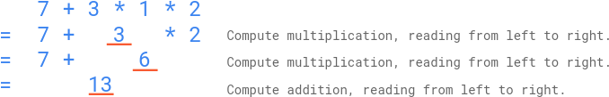

# [2019. The Score of Students Solving Math Expression](https://leetcode.com/problems/the-score-of-students-solving-math-expression/)

| Category | Difficulty | Likes | Dislikes |
| :------: | :--------: | :---: | :------: |
| Algorithms | Hard | 281 | 85 |

**Tags:** [`array`](https://leetcode.com/tag/array), [`hash-table`](https://leetcode.com/tag/hash-table), [`math`](https://leetcode.com/tag/math), [`string`](https://leetcode.com/tag/string), [`dynamic-programming`](https://leetcode.com/tag/dynamic-programming), [`stack`](https://leetcode.com/tag/stack), [`memoization`](https://leetcode.com/tag/memoization)

**Companies:** `facebook`, `flipkart`

## Description

You are given a string `s` that contains digits `0-9`, addition symbols `'+'`, and multiplication symbols `'*'` **only**, representing a **valid** math expression of **single digit numbers** (e.g., `3+5*2`). This expression was given to `n` elementary school students. The students were instructed to get the answer of the expression by following this **order of operations**:

	- Compute **multiplication**, reading from **left to right**; Then,

	- Compute **addition**, reading from **left to right**.

You are given an integer array `answers` of length `n`, which are the submitted answers of the students in no particular order. You are asked to grade the `answers`, by following these **rules**:

	- If an answer **equals** the correct answer of the expression, this student will be rewarded `5` points;

	- Otherwise, if the answer **could be interpreted** as if the student applied the operators **in the wrong order** but had **correct arithmetic**, this student will be rewarded `2` points;

	- Otherwise, this student will be rewarded `0` points.

Return *the sum of the points of the students*.

 

**Example 1:**


```

Input: s = &quot;7+3*1*2&quot;, answers = [20,13,42]
Output: 7
Explanation: As illustrated above, the correct answer of the expression is 13, therefore one student is rewarded 5 points: [20,13,42]
A student might have applied the operators in this wrong order: ((7+3)*1)*2 = 20. Therefore one student is rewarded 2 points: [20,13,42]
The points for the students are: [2,5,0]. The sum of the points is 2+5+0=7.

```

**Example 2:**

```

Input: s = &quot;3+5*2&quot;, answers = [13,0,10,13,13,16,16]
Output: 19
Explanation: The correct answer of the expression is 13, therefore three students are rewarded 5 points each: [13,0,10,13,13,16,16]
A student might have applied the operators in this wrong order: ((3+5)*2 = 16. Therefore two students are rewarded 2 points: [13,0,10,13,13,16,16]
The points for the students are: [5,0,0,5,5,2,2]. The sum of the points is 5+0+0+5+5+2+2=19.

```

**Example 3:**

```

Input: s = &quot;6+0*1&quot;, answers = [12,9,6,4,8,6]
Output: 10
Explanation: The correct answer of the expression is 6.
If a student had incorrectly done (6+0)*1, the answer would also be 6.
By the rules of grading, the students will still be rewarded 5 points (as they got the correct answer), not 2 points.
The points for the students are: [0,0,5,0,0,5]. The sum of the points is 10.

```

 

**Constraints:**

	- `3 9 in intermediate steps of multiplication.

	- `n == answers.length`

	- `1 <= n <= 10^4`

	- `0 <= answers[i] <= 1000`

---

**Links:** [Submissions](https://leetcode.com/problems/the-score-of-students-solving-math-expression/) | [Solutions](https://leetcode.com/problems/the-score-of-students-solving-math-expression/)
