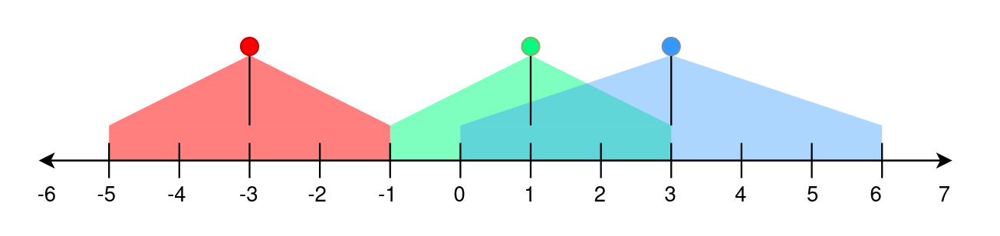

# [2021. Brightest Position on Street](https://leetcode.com/problems/brightest-position-on-street/)

| Category | Difficulty | Likes | Dislikes |
| :------: | :--------: | :---: | :------: |
| Algorithms | Medium | 171 | 5 |

**Tags:** [`array`](https://leetcode.com/tag/array), [`sorting`](https://leetcode.com/tag/sorting), [`prefix-sum`](https://leetcode.com/tag/prefix-sum), [`ordered-set`](https://leetcode.com/tag/ordered-set)

**Companies:** `tiktok`, `roblox`, `capital-one`, `uber`, `visa`, `robinhood`

## Description

A perfectly straight street is represented by a number line. The street has street lamp(s) on it and is represented by a 2D integer array `lights`. Each `lights[i] = [position_i, range_i]` indicates that there is a street lamp at position `position_i` that lights up the area from `[position_i - range_i, position_i + range_i]` (**inclusive**).

The **brightness** of a position `p` is defined as the number of street lamp that light up the position `p`.

Given `lights`, return *the **brightest** position on the** street. If there are multiple brightest positions, return the **smallest** one.*

 

**Example 1:**


```

Input: lights = [[-3,2],[1,2],[3,3]]
Output: -1
Explanation:
The first street lamp lights up the area from [(-3) - 2, (-3) + 2] = [-5, -1].
The second street lamp lights up the area from [1 - 2, 1 + 2] = [-1, 3].
The third street lamp lights up the area from [3 - 3, 3 + 3] = [0, 6].

Position -1 has a brightness of 2, illuminated by the first and second street light.
Positions 0, 1, 2, and 3 have a brightness of 2, illuminated by the second and third street light.
Out of all these positions, -1 is the smallest, so return it.

```

**Example 2:**

```

Input: lights = [[1,0],[0,1]]
Output: 1
Explanation:
The first street lamp lights up the area from [1 - 0, 1 + 0] = [1, 1].
The second street lamp lights up the area from [0 - 1, 0 + 1] = [-1, 1].

Position 1 has a brightness of 2, illuminated by the first and second street light.
Return 1 because it is the brightest position on the street.

```

**Example 3:**

```

Input: lights = [[1,2]]
Output: -1
Explanation:
The first street lamp lights up the area from [1 - 2, 1 + 2] = [-1, 3].

Positions -1, 0, 1, 2, and 3 have a brightness of 1, illuminated by the first street light.
Out of all these positions, -1 is the smallest, so return it.

```

 

**Constraints:**

	- `1 <= lights.length <= 10^5`

	- `lights[i].length == 2`

	- `-10^8 <= position_i <= 10^8`

	- `0 <= range_i <= 10^8`

---

**Links:** [Submissions](https://leetcode.com/problems/brightest-position-on-street/) | [Solutions](https://leetcode.com/problems/brightest-position-on-street/)
