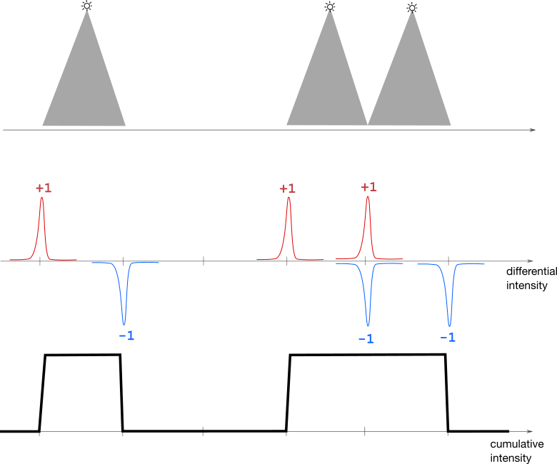

# sorting ^^

**Author:** andrii_khlevniuk
**Votes:** 1
**Link:** [https://leetcode.com/problems/brightest-position-on-street/solutions/2037354/](https://leetcode.com/problems/brightest-position-on-street/solutions/2037354/)

---



The algo reminds delta-functions technique in physics.

**`map` does the sorting**
```
int brightestPosition(vector<vector<int>>& l)
{
	map<int, int> m;
	for(const auto & i : l) 
		++m[i[0]-i[1]], --m[i[0]+i[1]+1];

	int p{};
	for(int b{}, B{}; const auto & [i,j] : m)
		if((b+=j)>B) B=b, p=i;    
	return p; 
}
```
||
**two vectors + sorting**
```
int brightestPosition(vector<vector<int>>& l)
{
	vector<int> left(size(l)), right(size(l));
	for(int i{}; i<size(l); ++i) 
		left[i]=l[i][0]-l[i][1], right[i]=l[i][0]+l[i][1]+1;

	sort(begin(left),  end(left));
	sort(begin(right), end(right));

	int p{};
	for(int i{}, j{}, B{}, b{}, pos{}; i<size(l) or j<size(l); )
	{
		if(i<size(l) and (j==size(l) or left[i]<right[j]))
			++b, pos=left[i++];
		else
			--b, pos=right[j++];
		if(b>B) B=b, p=pos;    
	}
	return p; 
}
```
[Here's](https://leetcode.com/problems/count-positions-on-street-with-required-brightness/discuss/2037191/linear) similar problem.