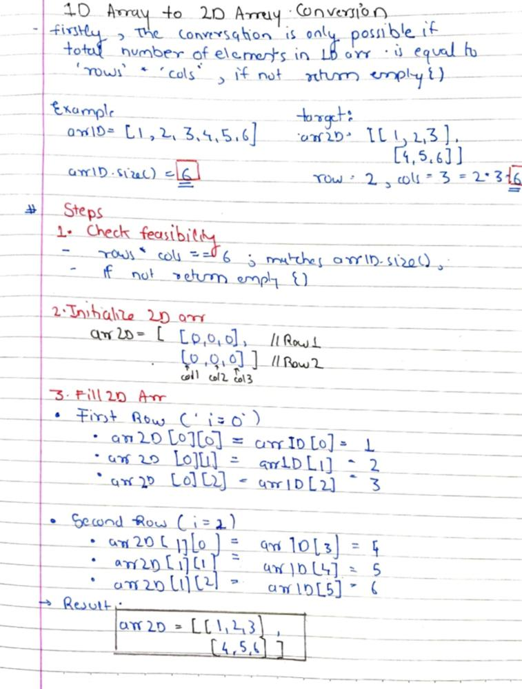

# ✅ Easy Basic C++/ Java / Py / JS Solution | 📝 Pen-Paper Visualization ✏|

**Author:** dev_yash_
**Votes:** 24
**Link:** [https://leetcode.com/problems/convert-1d-array-into-2d-array/solutions/5717945/](https://leetcode.com/problems/convert-1d-array-into-2d-array/solutions/5717945/)

---

### Visualization




## C++
**T.C= O(m*n) [Brute Force]**
```
class Solution {
public:
    vector<vector<int>> construct2DArray(vector<int>& arr1D, int rows, int cols) {
        // Initialize a 2D vector with 'rows' number of rows and 'cols' number of columns
        vector<vector<int>> arr2D(rows, vector<int>(cols));

        // Check if the total elements in the 1D array match the required elements in the 2D array
        if (rows * cols != arr1D.size()) {
            return {};  // Return an empty vector if the dimensions don't match
        }

        // Fill the 2D array with elements from the 1D array
        for (int i = 0; i < rows; i++) {        
            for (int j = 0; j < cols; j++) {    
                // Calculate the correct index in the 1D array and assign the value to the 2D array
                arr2D[i][j] = arr1D[i * cols + j];
            }
        }

        
        return arr2D;
    }
};

```
**T.C= O(N)  [Optimised]**
```
class Solution {
public:
    vector<vector<int>> construct2DArray(vector<int>& arr1D, int rows, int cols) {
      
        if (rows * cols != arr1D.size()) {
            return {};  // Return an empty vector if the dimensions don't match
        }

        // Initialize the 2D array and fill it in one pass
        vector<vector<int>> arr2D(rows, vector<int>(cols));
        for (int i = 0; i < rows * cols; i++) {
            arr2D[i / cols][i % cols] = arr1D[i];
        }

        return arr2D;
    }
};
```

## Java
**T.C=O(m*n) [Brute Force]**
```
class Solution {
    public int[][] construct2DArray(int[] original, int m, int n) {
        // Check if the total elements in the original array match the required elements in the 2D array
        if (m * n != original.length) {
            return new int[0][0]; // Return an empty 2D array if dimensions don't match
        }

        // Initialize a 2D array with 'm' rows and 'n' columns
        int[][] arr2D = new int[m][n];

        // Fill the 2D array with elements from the 1D array
        for (int i = 0; i < m; i++) {       
            for (int j = 0; j < n; j++) {    
                // Calculate the correct index in the 1D array and assign the value to the 2D array
                arr2D[i][j] = original[i * n + j];
            }
        }

    
        return arr2D;
    }
}

```
**T.C O(N) [Optimised]**
```
class Solution {
    public int[][] construct2DArray(int[] arr1D, int rows, int cols) {
      
        if (rows * cols != arr1D.length) {
            return new int[0][0];  // Return an empty array if the dimensions don't match
        }

        // Initialize the 2D array and fill it in one pass
        int[][] arr2D = new int[rows][cols];
        for (int i = 0; i < rows * cols; i++) {
            arr2D[i / cols][i % cols] = arr1D[i];
        }

        return arr2D;
    }
}

```

## Python
```
import numpy as np;
class Solution:
    def construct2DArray(self, original: List[int], m: int, n: int) -> List[List[int]]:
    
        if len(original) != m * n:
            return []  
        
        # Use NumPy to reshape the 1D array into a 2D array
        arr2D = np.array(original).reshape(m, n)
        return arr2D.tolist()  
```

## Javascript
```
/**
 * @param {number[]} original
 * @param {number} m
 * @param {number} n
 * @return {number[][]}
 */
var construct2DArray = function(original, m, n) {
    // Check if the total elements in the original array match the required elements in the 2D array
    if (m * n !== original.length) {
        return []; // Return an empty array if dimensions don't match
    }

    // Initialize a 2D array with 'm' rows
    const arr2D = [];

    // Fill the 2D array with elements from the 1D array
    for (let i = 0; i < m; i++) {
        // Slice the original array to get the elements for the current row
        arr2D.push(original.slice(i * n, i * n + n));
    }


    return arr2D;
};

```

##### **STAY COOL STAY DISCIPLINED..!**

