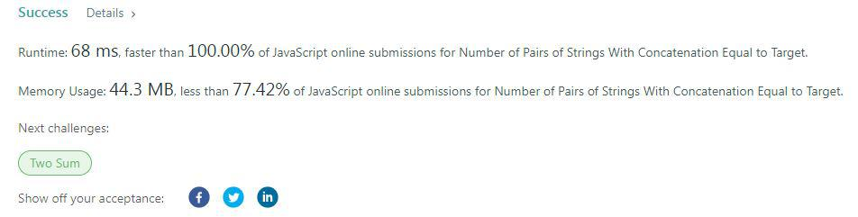

# Javascript solution | faster than 100%

**Author:** anshulanand02
**Votes:** 4
**Link:** [https://leetcode.com/problems/number-of-pairs-of-strings-with-concatenation-equal-to-target/solutions/1663989/](https://leetcode.com/problems/number-of-pairs-of-strings-with-concatenation-equal-to-target/solutions/1663989/)

---


```
/**
 * @param {string[]} nums
 * @param {string} target
 * @return {number}
 */
var numOfPairs = function(nums, target) {
    var count = 0;
    var x = 0;
    while (x < nums.length) {
        for (let y = 0; y<nums.length; y++) {
            if (nums[x] + nums[y] == target) {
                count += 1;
                if (x == y) {
                    count -= 1;
                }
            }
        }
        x++;
    }
    return count;
};
```